<p align="center"><a href="https://johnmorrisdotca.github.io/fuda-cards/"><picture><source media="(prefers-color-scheme: dark)" srcset="https://raw.githubusercontent.com/johnmorrisdotca/fuda-cards/main/docs/images/thumbnail-dark.png">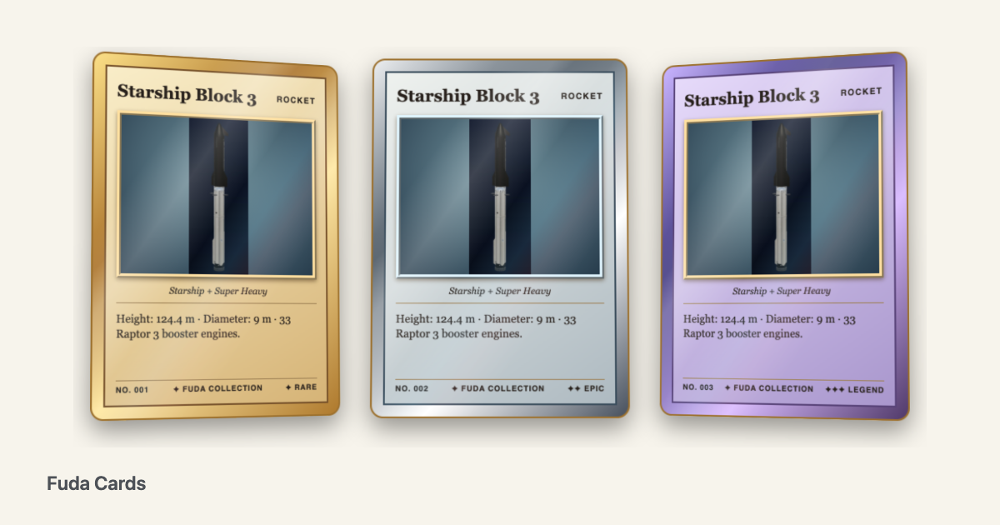</picture></a></p>

<h1 align="center">Fuda Cards <sub>札</sub> — collectible card frames for the web</h1>

<p align="center"><strong>Cards with a true thickness, a stack, a worn corner and a binder to put them in, as two web components.</strong><br>
`&lt;fuda-card&gt;` frames a picture or a live 3D viewer; `&lt;fuda-collection&gt;` shows a whole collection in ten displays. Plain HTML, React, Vue, Svelte and Angular. No framework and no 3D engine required.</p>

<p align="center">
  <a href="https://github.com/johnmorrisdotca/fuda-cards/actions/workflows/pages.yml"></a>
  <a href="https://www.npmjs.com/package/@johnmorrisdotca/fuda-cards"></a>
  
  
</p>

<p align="center"><a href="https://johnmorrisdotca.github.io/fuda-cards/"><strong>Open the Card Studio →</strong></a> · <a href="https://github.com/johnmorrisdotca/fuda-cards/blob/main/docs/guides/getting-started.md">Getting started</a> · <a href="https://github.com/johnmorrisdotca/fuda-cards/blob/main/docs/API.md">API reference</a> · <a href="https://github.com/johnmorrisdotca/fuda-cards/blob/main/docs/guides">All guides</a></p>

<table align="center">
<tr>
<td align="center" valign="top">
<picture>
<source media="(prefers-color-scheme: dark)" srcset="https://raw.githubusercontent.com/johnmorrisdotca/fuda-cards/main/docs/images/studio-desk-dark.webp">
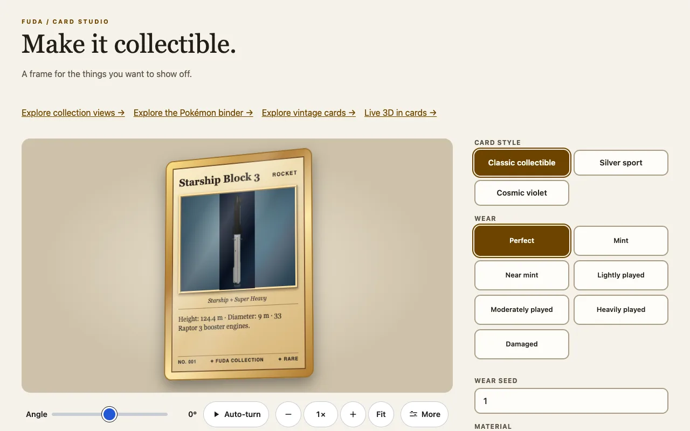
</picture>
<br><em>The Card Studio on a desk.</em>
</td>
<td align="center" valign="top">
<picture>
<source media="(prefers-color-scheme: dark)" srcset="https://raw.githubusercontent.com/johnmorrisdotca/fuda-cards/main/docs/images/studio-phone-dark.webp">
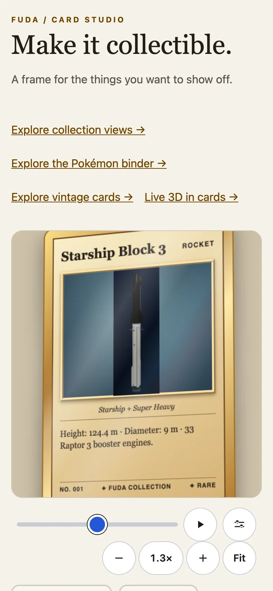
</picture>
<br><em>The same on a phone, in the device's light or dark.</em>
</td>
</tr>
</table>

Fuda Cards is for a page that wants to show things people collect: trading cards, vintage cards, consoles, rockets. A card is a frame around a picture you supply, or around a live 3D viewer, drawn with a thickness to scale, an edge, a back, and wear if you want it. A collection is a shelf of them in a binder, a fan, a deck, a wall. The picture is always yours: Fuda stores nothing, hosts nothing and asks for no account.

This is an early package: classic, sport and cosmic are exploratory CSS designs, not yet historically researched recreations or photorealistic materials. The demos use a still from Uchusen Rockets; [assets/README.md](assets/README.md) has its model credit.

## In 30 seconds

```sh
npm install @johnmorrisdotca/fuda-cards
```

```html
<script type="module">
  import '@johnmorrisdotca/fuda-cards/element';
</script>
<fuda-card title="Explorer One" category="ROCKET" variant="cosmic" finish="foil" description="A new explorer.">
  
</fuda-card>
```

And the tables behind it, in script, with no page at all:

```ts
import { cardMaterial, stackHeightMm, wearPresets } from '@johnmorrisdotca/fuda-cards';

const stock = cardMaterial('paper-310-black-core');
console.log(stock?.name, stock?.thicknessMm);
console.log(stackHeightMm(52, stock?.thicknessMm ?? 0.3));
console.log(wearPresets.map((preset) => preset.id).join(' '));
// Playing-card stock, black core, 310 gsm (13 pt) 0.325
// 16.9
// perfect mint near-mint lightly-played moderately-played heavily-played damaged
```

## Who it is for

- A site that sells, catalogues or shows off cards, and wants a card that looks like one: thickness, edge, back, wear.
- A project with a 3D viewer (a rocket, a device) that wants it to sit in a card, turning only when the card is in focus.
- A collector who wants a binder, a deck on a table or a fan of cards for their own pictures.
- Anyone who needs it in a framework: it is a standard custom element, so React, Vue, Svelte, Angular and plain HTML all work.

## Features

- **A true-scale card.** Thickness in millimetres at the 63 mm card size, a drawn edge, a back, a foil or matte finish, three frame variants.
- **Sourced materials.** Thirteen materials, each thickness read from a maker or a standard and cited.
- **Stacks.** One card to a thousand, as high as the count times the thickness, a seeded messiness.
- **Wear.** Six grading presets, a seed, and one dial for corners, edges, surface and creases.
- **Motion.** A pan over a tall picture, autoplay on the card in focus, a spin about the centre or a corner.
- **Piles.** Fan open, take a card off, land it face up or turned over.
- **Ten displays** for a collection, a ring or zip binder that turns real pages among them.
- **Live 3D on one WebGL context.** One card at a time turns; the rest are pictures.
- **Zoom, Fit and move** in every display, with the address kept in the link.
- **Light and dark,** keyboard, touch and reduced motion built in.

## Install

```sh
npm install @johnmorrisdotca/fuda-cards
```

Requires Node 22 or later for the tooling; the elements run in any current browser. `@johnmorrisdotca/kazoku-ui` comes with it (it draws the zoom bar). `three` is an optional peer dependency, needed only for live 3D. The package is ES modules with TypeScript declarations in `dist/`.

## Use it in your project

In a bundler, import the element once before rendering it. Anywhere that runs in the browser will do.

```ts no-run
import '@johnmorrisdotca/fuda-cards/element';
import '@johnmorrisdotca/fuda-cards/collection-element';
import type { CardOptions } from '@johnmorrisdotca/fuda-cards';

const options: CardOptions = { title: 'Relic', thickness: 1.5, wear: 'near-mint' };
const card = document.createElement('fuda-card');
card.setAttribute('title', options.title ?? '');
card.setAttribute('thickness', String(options.thickness));
document.body.append(card);
```

The main entry, `@johnmorrisdotca/fuda-cards`, exports only the options types and the tables (variants, finishes, materials, stack presets, wear presets and their maths) and registers nothing, so it is safe on a server. Frameworks may need a custom-element setting (Angular's `CUSTOM_ELEMENTS_SCHEMA`, Vue's `isCustomElement`): see [Frameworks](https://github.com/johnmorrisdotca/fuda-cards/blob/main/docs/guides/frameworks.md).

## Use it anywhere

With no bundler, serve the package's `dist` folder and point a module script at it:

```html
<script type="importmap">
{ "imports": { "@johnmorrisdotca/fuda-cards/element": "/node_modules/@johnmorrisdotca/fuda-cards/dist/element.js" } }
</script>
<script type="module">import '@johnmorrisdotca/fuda-cards/element';</script>
<fuda-card title="Anywhere"></fuda-card>
```

`<fuda-collection>` imports kazoku-ui's zoom bar, so it also needs `@johnmorrisdotca/kazoku-ui/view-controls/define` in the import map; the [HTML and CDN guide](https://github.com/johnmorrisdotca/fuda-cards/blob/main/docs/guides/html-and-cdn.md) has the whole map.

## Examples

A card with a back and a thick edge, a deck, a worn card, a collection. Each of these is run in a browser by `pnpm test:readme`.

```html
<script type="module">import '@johnmorrisdotca/fuda-cards/element';</script>
<fuda-card title="Relic" thickness="1.5"></fuda-card>
<fuda-card title="Deck" material="paper-310-black-core" stack="52" stack-messiness="0.3" stack-seed="7"></fuda-card>
<fuda-card title="Rookie" wear="moderately-played" wear-seed="7"></fuda-card>
```

```html
<fuda-collection view="deck"></fuda-collection>
<script type="module">
  import '@johnmorrisdotca/fuda-cards/collection-element';
  document.querySelector('fuda-collection').cards = [
    { id: 'one', name: 'My card', image: '/cards/front.jpg', backImage: '/cards/back.jpg' }
  ];
</script>
```

## The card

`<fuda-card>` has the attributes `title`, `category`, `subtitle`, `description`, `number`, `rarity`, `variant` (`classic`, `sport`, `cosmic`), `finish` (`foil`, `matte`), `thickness` (millimetres, default `0.3`), `material`, `stack`, `wear` and `flipped` (boolean). Set the element's width to scale it; it keeps the 2.5 by 3.5 proportion of a real card. The default slot accepts HTML, including an existing interactive 3D viewer: its owner handles rotation, zoom and model loading, and the card has no drag-to-flip handler. Control the reverse by adding or removing `flipped`.

```ts
import { cardFinishes, cardVariants } from '@johnmorrisdotca/fuda-cards';

console.log(cardVariants.join(' '), cardFinishes.join(' '));
// classic sport cosmic foil matte
```

Every attribute, property and CSS variable is in [The card element](https://github.com/johnmorrisdotca/fuda-cards/blob/main/docs/guides/card-element.md).

## No flash before the card is ready

A card never shows the art it is about to frame. Until the script has defined `<fuda-card>`, a browser draws your `` at its natural size, so the whole picture flashes before it moves into the frame. Put this one line in the `<head>`, before the script and your own styles, and the card stays invisible while its box is already reserved at the card's size (nothing moves when it appears):

```html no-check
<style>fuda-card:where(:not(:defined)){display:inline-block;width:300px;aspect-ratio:2.5/3.5;overflow:hidden;visibility:hidden}fuda-collection:where(:not(:defined)){display:block;min-height:calc(var(--fuda-stage-height,clamp(300px,calc(100svh - 440px),620px)) + 380px)}</style>
```

It keeps `<fuda-card>` (300 px wide, 2.5:3.5, or whatever width your own rule gives it) and `<fuda-collection>` (the height of its view, `--fuda-stage-height`) in place. Once defined, the card also keeps the art invisible until the card has a size on screen and every slotted image has loaded, then fades it in (no fade with `prefers-reduced-motion`). Without the line the card still reveals the art only inside its frame after it is defined, but the browser may show the raw picture until your script runs. If scripts never run, the card stays blank; add `<noscript><style>fuda-card:not(:defined){visibility:visible}</style></noscript>` if you want the plain picture then.

## Back face and thickness

A card turned past 90° shows its back (the navy FUDA face), never the mirrored front, and the front's Animate button cannot be seen or clicked from behind. The back is the card's own face and is shown for `flipped` too.

The card has thickness, drawn to scale at the 63 mm wide card size: set `thickness` in millimetres (default `0.325`, a playing card's black-core stock, 13 pt, `DEFAULT_CARD_THICKNESS_MM`; `0` for a flat card; or pick a `material`, below). The edge is drawn from thin planes between the two faces, so it shows edge-on and at any angle, and it scales with the element's width (a 300px card is about 1.4px thick at the default). It is gold foil for the classic gold frame and card-stock cream for the sport and cosmic variants; override it with the `--fuda-edge` CSS custom property (any CSS background). The drop shadow is on the element itself, so a `filter` must not be added to anything between the card and its faces.

```html
<script type="module">import '@johnmorrisdotca/fuda-cards/element';</script>
<fuda-card title="Relic" thickness="1.5" flipped></fuda-card>
```

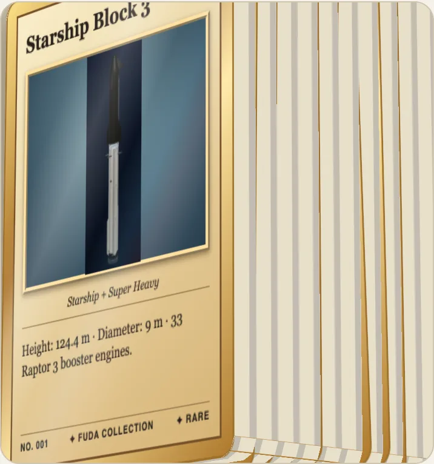

## Materials and stacks

`material="<id>"` gives a card the thickness and edge colour of a material, each thickness read from a maker or a standard and cited: card stock at 11, 13 and 16 pt, a plastic bank-size card (0.76 mm), thick trading cards from 35 to 180 pt, a 175 pt booklet card, anodised aluminium (0.8 mm) and stainless steel (0.5 mm). `thickness` still overrides it. [docs/materials.md](docs/materials.md) lists every material, its thickness, its source and what the source says, and what was left out because it could not be sourced (a patch or relic card, for one).

`stack="52"` draws that many cards as a stack whose height is the count times a card's thickness (52 cards of the black-core playing-card stock are 16.9 mm). The count is free, 1 to 1000; the Card Studio has presets with a source (52 playing cards, 52 and two jokers, a 60-card Pokémon deck, a booster pack of 10). Turn the card to see the stack's edge, with a line for each card in the material's colour.

```html
<script type="module">import '@johnmorrisdotca/fuda-cards/element';</script>
<fuda-card title="Deck" material="paper-310-black-core" stack="52" stack-messiness="0.3" stack-seed="7"></fuda-card>
```

The top card is the live card. The block under it is one piece, and with `stack-messiness` above 0 (0 neat to 1 very messy, default 0.3) the `stack-depth` cards under the top one (default 10, at most 52) are drawn as flat stills, nudged and turned from `stack-seed`: the same seed gives the same stack, and a card put on top moves none of those under it. A stack is one 3D scene whatever its count, and it draws nothing while it is at rest: a test checks that a 52-card stack requests no frames at rest. The idea of a pile from neat to messy and its parameters come from [toranpu](https://github.com/johnmorrisdotca/toranpu)'s `<toranpu-pile>`. In script, `card.stackCount` and `card.stackHeight` (mm) are read-only, and the package exports `cardMaterials`, `stackPresets`, `stackHeightMm` and `stackLayout`.

<picture>
<source media="(prefers-color-scheme: dark)" srcset="https://raw.githubusercontent.com/johnmorrisdotca/fuda-cards/main/docs/images/stack-desk-dark.webp">
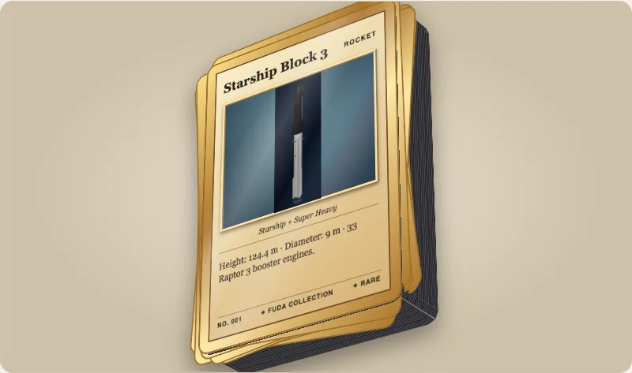
</picture>
<br><em>A stack of 52 cards, slightly messy.</em>

More in [Materials and stacks](https://github.com/johnmorrisdotca/fuda-cards/blob/main/docs/guides/materials-and-stacks.md).

## Fan a stack, take a card off it

A stack of more than one card is a pile like the collection's deck, with the same fan and the same landing. `fan="open"` spreads up to ten cards in an arc (every card drawn with its face and the picture) and closes back exactly where they began. `taken-off="3"` puts the top three cards on a pile at the stack's side, as thick as the cards in it: `card.takeOff()` flies the top card across and `card.putBack()` brings it back, and `deck-land="face-up"` (the default) or `"face-down"` (turned over sideways, showing the back) says how it lands. `pile-controls` draws three buttons (Fan, Take a card off, Put it back; each at least 48 px) under the card; leave about 70 px of room below it. `animate="off"` and `speed="slow|quick"` are the same as in the collection. The card turns with the pile (the angle, tilt and Auto-turn work as before) and an open fan or a pile at the side is part of what turns: `card.pileBounds` says how far they reach beyond the card, in card widths, and `fuda-pile` is sent when it changes, so a page can fit its view.

```html
<script type="module">import '@johnmorrisdotca/fuda-cards/element';</script>
<fuda-card title="Deck" stack="52" pile-controls></fuda-card>
```

The pile code is a separate module (`dist/pile-card.js`) that `<fuda-card>` loads only when a stack asks for `fan`, `taken-off` or `pile-controls`; a card without them is drawn exactly as before and never requests it. See [Binders and piles](https://github.com/johnmorrisdotca/fuda-cards/blob/main/docs/guides/binder-and-piles.md).

<picture>
<source media="(prefers-color-scheme: dark)" srcset="https://raw.githubusercontent.com/johnmorrisdotca/fuda-cards/main/docs/images/fan-desk-dark.webp">
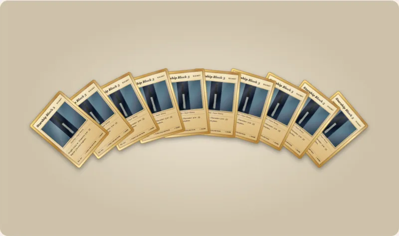
</picture>
<br><em>A stack fanned open.</em>

## Wear: cards that are not perfect

`wear="lightly-played"` draws the card after use: corners that are soft, rounded, chipped or folded (a dog-ear), whitening on the edges, creases, scratches, specks, staining, yellowing and a print that sits off centre. The presets are the plain grading terms: `mint`, `near-mint`, `lightly-played`, `moderately-played`, `heavily-played` and `damaged`; `perfect`, no attribute at all, or an unknown name draws nothing. `wear-seed` fixes where the marks lie, so a card looks the same every time it is drawn. `wear-corners`, `wear-edges`, `wear-surface` and `wear-creases` (0 to 1) change one kind on its own, and `wear="0.5"` sets them all at once.

```html
<script type="module">import '@johnmorrisdotca/fuda-cards/element';</script>
<fuda-card title="Rookie" wear="moderately-played" wear-seed="7"></fuda-card>
```

A perfect card is byte for byte what it was: the wear code is a separate module that `<fuda-card>` loads only when a card asks for wear. [docs/wear.md](docs/wear.md) has the sources for the grading words, the presets with their levels, how each mark is drawn and what is not drawn. The package exports `wearPresets`, `wearPreset`, `wearLayout`, `wearLevels`, `wearOutline` and `wearOverlaySvg` as plain data. See [Wear](https://github.com/johnmorrisdotca/fuda-cards/blob/main/docs/guides/wear.md).

<picture>
<source media="(prefers-color-scheme: dark)" srcset="https://raw.githubusercontent.com/johnmorrisdotca/fuda-cards/main/docs/images/wear-desk-dark.webp">
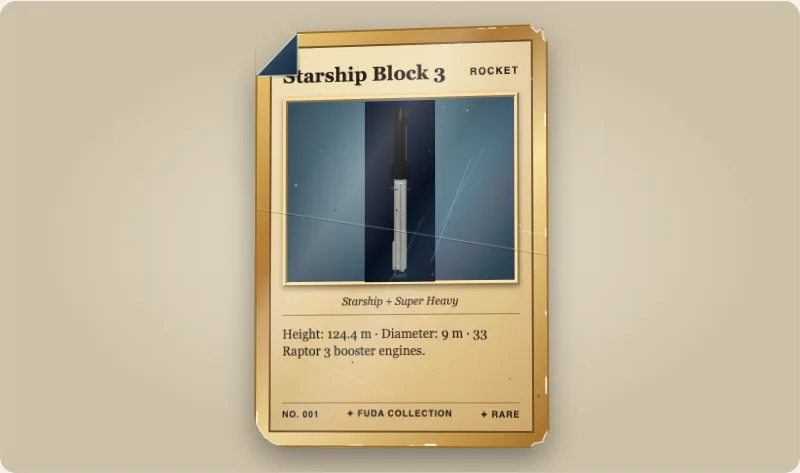
</picture>
<br><em>A heavily played card.</em>

## Whole-card rotation

Set `card-spin="center"` for a slow 3D turn around the card's vertical center, or `card-spin="corner"` for a 3D spin like an ice skater: the card keeps its full size and turns a full 360° around the vertical axis through its bottom-left corner, which stays still at the middle of the element, and shows its back half way round. The card sweeps out to both sides of that point, so give it room (a stage about three times its width and twice its height). The default is one turn every 180 seconds; set `--fuda-card-spin-duration` to a positive CSS duration such as `30s`. `card-spin-direction="reverse"` reverses the rotation, `card-spin-paused` pauses at the current angle, and removing `card-spin` stops and resets it. These attributes are independent of the artwork `motion` and `playing` attributes and the card's `flipped` state. Reduced-motion preferences disable the rotation and the flip transition.

To drive the turn from your own controls instead of the built-in animation, add the boolean `card-view` attribute and set the CSS custom properties `--fuda-yaw` and `--fuda-tilt` (angles, for example `40deg`); the pivot is the one chosen by `card-spin`. The Card Studio does this with [`@johnmorrisdotca/kazoku-ui`](https://www.npmjs.com/package/@johnmorrisdotca/kazoku-ui) view controls (angle, tilt, Auto-turn, Front, zoom out, 2x, zoom in, Fit, pan, drag and pinch, kept in the address). `--fuda-perspective` (default `1000px`) sets the card's perspective.

```html
<script type="module">import '@johnmorrisdotca/fuda-cards/element';</script>
<fuda-card title="Explorer" card-spin="center" style="--fuda-card-spin-duration: 30s">
  
</fuda-card>
```

## Moving artwork

Set `motion="pan"` on a card containing a slotted `` to enable the Animate button on a tall image. The button is a small play or pause mark in the corner of the art; its hit target is 48 px square, its accessible name is "Animate the picture" and `aria-pressed` says whether the art is moving. By default the card starts on a still, cropped view; add the boolean `playing` attribute to start with motion. A host can add or remove `playing` to control the state. Set `--fuda-focus-x` and `--fuda-focus-y` (for example `50%` and `20%`) to choose the focal point. `pan-direction="up"` starts at the bottom; the default is down. The image travels back and forth by default; set `pan-loop="restart"` to repeat in one direction. `--fuda-pan-duration` (for example, `16s`) sets each pass. If the image is not taller than the window after filling its width, there may be no vertical distance to pan.

```html
<script type="module">import '@johnmorrisdotca/fuda-cards/element';</script>
<fuda-card title="Starship" motion="pan" pan-direction="down" style="--fuda-pan-duration: 16s">
  
</fuda-card>
```

**Autoplay when the card is in focus.** Add `autoplay="focus"` and the card moves its art by itself while it is the card in focus: the card under the mouse, the card that holds keyboard focus, or, on a touch screen, the card you last tapped. When focus moves, the first card returns to its still, so in a row or a grid only one card ever moves. It never starts with `prefers-reduced-motion: reduce`.

```html
<script type="module">import '@johnmorrisdotca/fuda-cards/element';</script>
<fuda-card title="Starship" motion="pan" autoplay="focus">
  
</fuda-card>
```

All of it is in [Motion and rotation](https://github.com/johnmorrisdotca/fuda-cards/blob/main/docs/guides/motion-and-spin.md).

## Live 3D in a card

A card can hold a live 3D item (a rocket, a device) that turns while the card is in focus. **Only one card is ever live, on one WebGL context for the whole page; every other card is a picture, and a page of pictures loads no 3D code at all.** `three` is yours (an optional peer dependency) and loads at the first focus:

```ts no-check
import { createLiveCards } from '@johnmorrisdotca/fuda-cards/live-3d';

const live = createLiveCards({ load: () => import('three') });
live.add(card, { key: 'cube', build({ three, assets, width, height }) { /* scene, camera, object */ } }, { still: card.querySelector('img') });
```

On a `<fuda-collection>`: `collection.live = { cards: live, item: (card) => itemFor(card) }`. Budgets, the focus rules and what cannot be proved in a test are in [docs/live-3d.md](docs/live-3d.md) and the [live 3D guide](https://github.com/johnmorrisdotca/fuda-cards/blob/main/docs/guides/live-3d.md); try it in the [live demo](https://johnmorrisdotca.github.io/fuda-cards/demo/live-3d.html).

## The collection viewer

Import `@johnmorrisdotca/fuda-cards/collection-element` to register the element, then set its `cards` property to an array of `{ id, name, image, backImage?, kind? }` (`kind` is `"card"`, the default, or `"object"`: a picture of a thing that is not a card, such as a games console, which has no back and no thickness and so never turns over). Image URLs are loaded by the viewer's browser. `id` is optional on input (the position is used if omitted); IDs must be unique.

```html
<fuda-collection view="deck"></fuda-collection>
<script type="module">
  import '@johnmorrisdotca/fuda-cards/collection-element';
  document.querySelector('fuda-collection').cards = [
    { id: 'one', name: 'My card', image: '/cards/front.jpg', backImage: '/cards/back.jpg' }
  ];
</script>
```

Check a list before handing it over: `parseCollection` is the same check the element runs.

```ts
import { parseCollection } from '@johnmorrisdotca/fuda-cards/collection';

console.log(parseCollection([{ name: 'Alpha', image: '/a.jpg' }]).map((card) => card.id).join(' '));
// 0
```

Collections, kinds and metadata are in [Collections](https://github.com/johnmorrisdotca/fuda-cards/blob/main/docs/guides/collections.md); the planned input features are in [docs/collection-input.md](docs/collection-input.md).

## Displays

Set `view` to `deck`, `rolodex`, `binder`, `case`, `random`, `story`, `wall`, `spotlight`, `atlas` or `fan` (`jukebox` and `tower`, dropped in 0.8.0, still open the deck). Set `page-size` for the binder and case (1–100 cards) and `columns` (1–10) for their grid; small screens use at most two columns. In random view, filter card names to limit the draw; the draw button is disabled when no cards match.

**Choosing a display.** The ten displays are a row of buttons across the top, each with a small picture of its layout and its name, at least 48 px high, one chosen, wrapping on a phone (4 to a row, 6 on a desk). It is a radio group: one tab stop, the arrow keys move the choice. There is no drop-down. The colours follow the reader's light or dark setting; set `theme="light"` or `theme="dark"` to choose for them.

**The deck, and the other piles.** Two displays draw a pile of cards, and each does everything a pile does: it turns in 3D, it fans open and closed, and a card comes off it onto a pile at its side. They are the Overlapping Deck (`view="deck"`) and Random Draw; the Fan of Cards is the same pile with only its fan. Rolodex and Spotlight Carousel spread their cards out instead of piling them, so they are carousels. `view="deck"` draws a deck of up to ten cards (with a seeded, slightly messy lie: `deck-messiness` 0 to 1, default 0.3, and `deck-seed`) and, beside it, a pile. **Next** flips the top card off the deck: it lifts, flies across and lands on the pile at the deck's other side; **Previous** brings it back. Where it lands is a choice: `deck-land="face-up"` (the default) or `face-down` ("Turned over": it turns over sideways about its vertical axis, like turning a page, so the pile shows the card's `backImage`, or the package's own navy back when it has none). A card never lands with its picture on its head. The 0.6.0 value `upside-down` is still accepted and means `face-down`. With reduced motion a card moves without flying.

<picture>
<source media="(prefers-color-scheme: dark)" srcset="https://raw.githubusercontent.com/johnmorrisdotca/fuda-cards/main/docs/images/deck-desk-dark.webp">
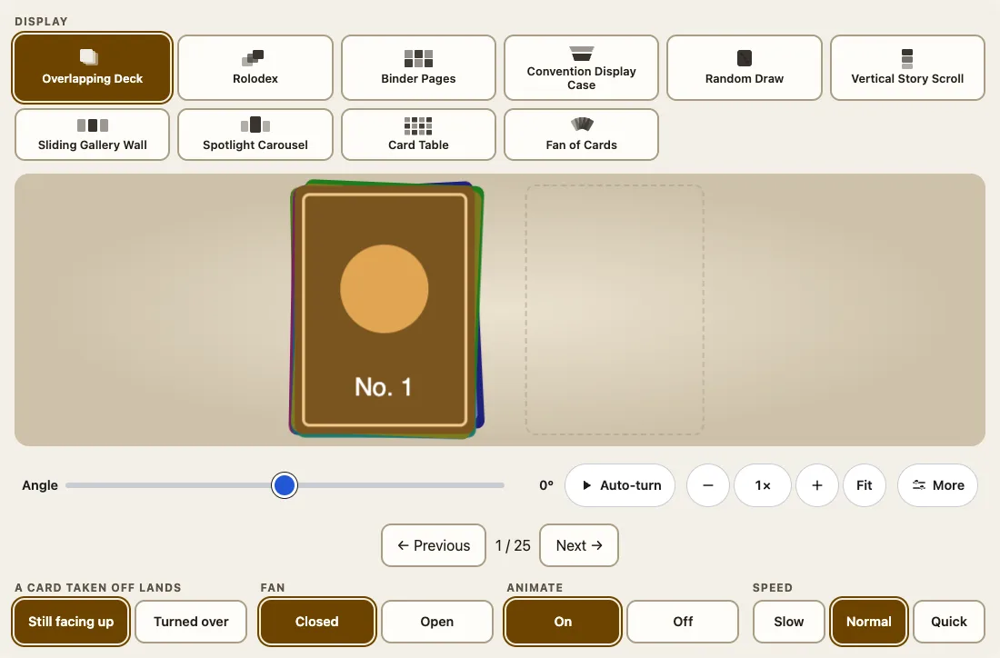
</picture>
<br><em>The Overlapping Deck with a card turned over onto the pile.</em>

**The fan.** Every pile fans open and closes with the **Fan** buttons right under the view (or `fan="open"`): up to ten cards spread in an arc like a hand of playing cards so that most of each card shows, and closing puts each card back exactly where it started. The pile beside the deck moves out of the way and the view fits the open fan (a phone included). `view="fan"` is the same pile with only its fan: `fan-size` (2 to 10) cards from the current one, Next moves the window on. The fan is in the address (`?fan=open`).

**Animate.** Opening and closing the fan, taking a card off, moving to the next card (Rolodex, Spotlight, the fan), changing a binder page and switching display all move; the wall, story and atlas pan to the card you move to. `animate="off"` turns all of it off (every move then ends at once, in exactly the same place), and `speed="slow"` or `"quick"` makes every move longer or shorter. `animate` is **on** when the attribute is missing; set `animate="off"` for the jump you had in 0.6.0. The reader's reduced-motion setting always wins.

<picture>
<source media="(prefers-color-scheme: dark)" srcset="https://raw.githubusercontent.com/johnmorrisdotca/fuda-cards/main/docs/images/wall-desk-dark.webp">
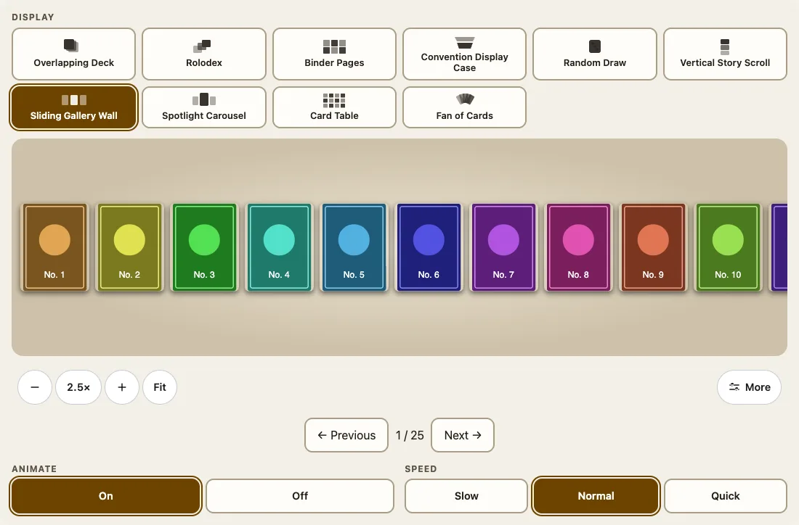
</picture>
<br><em>The Sliding Gallery Wall.</em>

## Binder pages

`view="binder"` is a binder open on two facing sheets, as one is kept: each sheet is a page of clear plastic pockets (nine, three by three) with a slight sheen, one card sitting inside each pocket, on a clear or a black sheet, with a strip of punched holes down the edge that lies against the rings. Next and Previous turn the page: a leaf swings about the spine, bends as it goes and shows the pockets on its back, forwards and backwards. Options, each a row of buttons under the view and in the address: `binder="ring|zip"` (a ring binder, or a zip binder with its zipper and pull), `cover="green|black|teal|navy|red"` (a plain cover), `sheet="clear|black"` and `pockets="4|9|12"` (two by two, three by three, four across by three down). The older `page-size` and `columns` still work and set the pockets of a sheet. Clicking a card opens it.

```html
<fuda-collection view="binder" binder="zip" cover="navy" sheet="black" pockets="12"></fuda-collection>
<script type="module">
  import '@johnmorrisdotca/fuda-cards/collection-element';
  document.querySelector('fuda-collection').cards = Array.from({ length: 30 }, (_, i) => ({ name: `Card ${i + 1}`, image: `/cards/${i + 1}.jpg` }));
</script>
```

<picture>
<source media="(prefers-color-scheme: dark)" srcset="https://raw.githubusercontent.com/johnmorrisdotca/fuda-cards/main/docs/images/binder-desk-dark.webp">
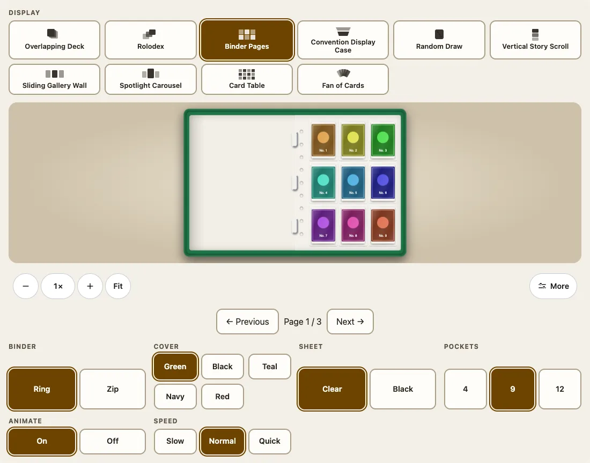
</picture>
<br><em>The binder, with the choices under it.</em>

## Zoom, Fit and move

Under each view sit the `@johnmorrisdotca/kazoku-ui` view controls: **−**, the zoom as a number (the one number on the bar, always the true one; a press goes back to Fit), **+** and **Fit**; **More** adds four arrows to move the view. Ctrl or Command with the wheel (or a trackpad pinch) and a two-finger pinch zoom about the pointer; zoomed in, a drag or the wheel moves the view, even when the drag starts on a card; the keys `+`, `−` and `0` work with the view focused. **Fit** shows every card the view draws. The wall, story and atlas open at half size or larger so a card can be read, and the others open at Fit. A tap or click on a card still opens it, and zooming, moving or paging never resets the other. Add the boolean `address` attribute to keep the zoom, the display, the fan, the landing, Animate and Speed in the page address (`?view=fan&fan=open&land=face-down&zoom=2`); a link to it opens the same view. Set `--fuda-stage-height` on the element to change the height of the view (default: the window height less 440 px, between 300 and 620 px) so the controls stay on screen.

## Frameworks

Set `cards` as a property in every framework, import the registration module only in the browser, and give your compiler the tag. React:

```jsx
import { useEffect, useRef } from 'react';
import '@johnmorrisdotca/fuda-cards/collection-element';

export function Cards({ cards }) {
  const ref = useRef(null);
  useEffect(() => { if (ref.current) ref.current.cards = cards; }, [cards]);
  return <fuda-collection ref={ref} view="binder" />;
}
```

Vue 3 (`:cards.prop`), Svelte and Angular (`CUSTOM_ELEMENTS_SCHEMA`) are in [Frameworks](https://github.com/johnmorrisdotca/fuda-cards/blob/main/docs/guides/frameworks.md), and server rendering in [TypeScript and Node](https://github.com/johnmorrisdotca/fuda-cards/blob/main/docs/guides/typescript-and-node.md). The integrations were bundled and exercised in Chromium with React 19, Angular 19, Vue 3 and Svelte 4; there are no framework wrappers yet.

## Demos

[Open the Fuda Cards demos](https://johnmorrisdotca.github.io/fuda-cards/). The Card Studio, the collection views, the Pokémon binder, the vintage cards and the live 3D page are built together for GitHub Pages. Run `pnpm site` to build the static site in `site/`; serve that directory to review it. The Pages workflow runs the checks and deploys the site on pushes to `main`.

**Builder.** [`demo/builder.html`](https://johnmorrisdotca.github.io/fuda-cards/demo/builder.html) is a page to choose a card or a collection, see it live and copy the HTML, React or Vue code for it. Every choice is a row of buttons, and the setup is kept in the link.

**Pokémon binder.** `demo/tcgdex.html` browses the Pokémon Base Set as full-card images supplied by [TCGdex](https://tcgdex.dev/). Search by name or number, change pages and select a card to enlarge it. This standalone demo fetches public set data and remote images in the browser, so it needs an internet connection. No API key, personal collection storage, or image hosting by Fuda is involved. Card images and metadata are provided by TCGdex; consult provider terms before deploying a public demo.

**Vintage cards.** `demo/vintage.html` shows real 1909 to 1911 hockey and baseball cards whose pictures are in the public domain (Wikimedia Commons and The Met's Open Access, each card's rights checked one by one), loaded from their sources and never shipped; [docs/card-images.md](docs/card-images.md) says what card-picture sources exist, their terms and what was not used.

**Demo collectors.** The collection demo has three fictional users, Alex, Sam and Riley, with different collections: Alex has 25 Base Set cards (a 5 by 5 page), Sam a pack of 10 and Riley 5 consoles. They are local demo profiles, not accounts. The demo can save, load and export named collections in the current browser's localStorage, scoped to the selected profile; this is not account-based sync or a backup.

<picture>
<source media="(prefers-color-scheme: dark)" srcset="https://raw.githubusercontent.com/johnmorrisdotca/fuda-cards/main/docs/images/vintage-desk-dark.webp">
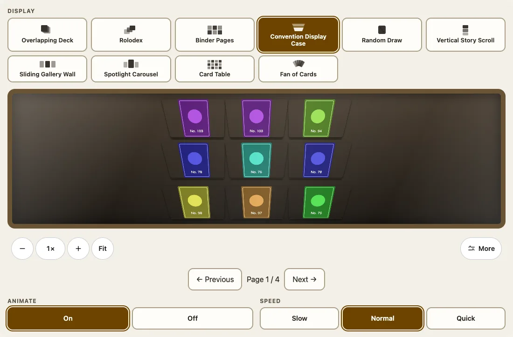
</picture>
<br><em>The vintage cards demo.</em>

## Theming

A collection follows the reader's light or dark setting; `theme="light"` or `theme="dark"` chooses for them. The card is sized by its width and styled through custom properties (`--fuda-edge`, `--fuda-perspective`, `--fuda-pan-duration`, `--fuda-card-spin-duration`, `--fuda-yaw`, `--fuda-tilt`, `--fuda-focus-x`, `--fuda-focus-y`) and a collection's view height by `--fuda-stage-height`. The frame's look is `variant` and `finish`.

```html
<script type="module">import '@johnmorrisdotca/fuda-cards/element';</script>
<style>fuda-card.brass { width: 220px; --fuda-edge: linear-gradient(90deg, #d9b45a, #8a6a22 50%, #d9b45a); --fuda-perspective: 1600px; }</style>
<fuda-card class="brass" title="Brass edge" thickness="2"></fuda-card>
```

The list, with the default of each, is in [Accessibility and theming](https://github.com/johnmorrisdotca/fuda-cards/blob/main/docs/guides/accessibility-and-theming.md).

## Accessibility

The display choices are a radio group with arrow keys; a card in a display is a button named "Inspect" and its name, opened with Enter or Space; every control is at least 48 px; the zoom keys are `+`, `-` and `0`; and with reduced motion the rotation, flip transition, pan, autoplay and live 3D are off while every move still ends in the same place. You supply the `alt` of your pictures. Tested in headless Chromium at a desk and a phone size; see the limits below.

## Limits

- **Early prototype.** Classic, sport and cosmic are exploratory CSS designs, not historically researched recreations or photorealistic materials. The case and rotating displays use CSS perspective rather than fully modelled 3D devices; the atlas is a zoomable, movable plane rather than an unbounded or virtualised canvas.
- **Tested in headless Chromium only,** drawing in software, at a desk and a phone size. A real phone, Safari and Firefox are not tested, and nothing measures a real GPU.
- **Wear** is not drawn on the images of a collection or on the cards under a stack's top card.
- **Images are yours.** Fuda hosts none; a missing image or failed request is reported in the demo's page.
- **Not built yet:** framework wrappers, scanned-card and JSON importers, search and filters, editing, large-collection virtualisation and accessibility validation by assistive-technology testing. [docs/feature-roadmap.md](docs/feature-roadmap.md) says what is partial and what is not started.

## Browser and runtime support

Current Chromium-based browsers are what is tested. The elements use custom elements, shadow DOM, CSS 3D transforms, container queries (`cqw`) and `:where`, which every current browser supports; Firefox and Safari are expected to work and are not tested. Node 22 or later is needed only to build and test, never to use the package. WebGL is needed only for live 3D, and the cards stay pictures without it. To load the elements only where custom elements exist:

```ts no-run
if ('customElements' in window) {
  await import('@johnmorrisdotca/fuda-cards/element');
}
```

## Languages

The elements' own words (button names, labels) are English today. The documentation is in English and Japanese: every guide in [docs/guides](https://github.com/johnmorrisdotca/fuda-cards/blob/main/docs/guides) has a Japanese twin in [docs/guides/ja](https://github.com/johnmorrisdotca/fuda-cards/blob/main/docs/guides/ja). Text on a card (title, subtitle, description) is whatever you give it in any language, and the page's language does not change it.

```html
<script type="module">import '@johnmorrisdotca/fuda-cards/element';</script>
<fuda-card title="エクスプローラー・ワン" category="ロケット" subtitle="新しい探査機" description="高さ124.4 m、直径9 m。"></fuda-card>
```

## Roadmap

Open work, in order of what a user would notice: framework wrappers; JSON, API and scanned-card importers and filters; the Hako Devices and Uchusen Rockets viewers inside card artwork; researched card designs for the recognisable families of the past century; configurable case geometry; large-collection virtualisation; and testing on a real phone, Safari and Firefox. The detail, with each item's status, is [docs/feature-roadmap.md](docs/feature-roadmap.md).

## Architecture

`element.js` is the card and loads the wear, pile and stack code only when a card asks for them; `collection-element.js` draws the ten displays; `live-3d.js` is the focus policy for one WebGL context. A page pays only for what it uses. The files and their sizes are in the [architecture guide](https://github.com/johnmorrisdotca/fuda-cards/blob/main/docs/guides/architecture.md).

## Documentation

| Guide | What it covers |
|---|---|
| [Getting started](https://github.com/johnmorrisdotca/fuda-cards/blob/main/docs/guides/getting-started.md) | A first card, a stack, a worn card and a collection |
| [The card element](https://github.com/johnmorrisdotca/fuda-cards/blob/main/docs/guides/card-element.md) | Every attribute, property and CSS variable |
| [Materials and stacks](https://github.com/johnmorrisdotca/fuda-cards/blob/main/docs/guides/materials-and-stacks.md) | Thickness, thirteen sourced materials, stacks |
| [Wear](https://github.com/johnmorrisdotca/fuda-cards/blob/main/docs/guides/wear.md) | Presets, the seed, wear as data |
| [Motion and rotation](https://github.com/johnmorrisdotca/fuda-cards/blob/main/docs/guides/motion-and-spin.md) | Pan, autoplay, spin, driving the turn |
| [Collections](https://github.com/johnmorrisdotca/fuda-cards/blob/main/docs/guides/collections.md) | The element, the input, kinds, ten displays |
| [Binders and piles](https://github.com/johnmorrisdotca/fuda-cards/blob/main/docs/guides/binder-and-piles.md) | Binder pages, fan, take a card off, animate |
| [Live 3D in a card](https://github.com/johnmorrisdotca/fuda-cards/blob/main/docs/guides/live-3d.md) | One card live on one context |
| [HTML and CDN](https://github.com/johnmorrisdotca/fuda-cards/blob/main/docs/guides/html-and-cdn.md) | A script tag from jsDelivr or unpkg, an import map |
| [Bundlers](https://github.com/johnmorrisdotca/fuda-cards/blob/main/docs/guides/bundlers.md) | Vite and webpack |
| [Frameworks](https://github.com/johnmorrisdotca/fuda-cards/blob/main/docs/guides/frameworks.md) | React, Vue, Svelte, Angular |
| [Embed in an iframe](https://github.com/johnmorrisdotca/fuda-cards/blob/main/docs/guides/embed-in-an-iframe.md) | The embed page and its address |
| [TypeScript and Node](https://github.com/johnmorrisdotca/fuda-cards/blob/main/docs/guides/typescript-and-node.md) | The types, and the tables on a server |
| [Accessibility and theming](https://github.com/johnmorrisdotca/fuda-cards/blob/main/docs/guides/accessibility-and-theming.md) | What is built in, every custom property |
| [Architecture](https://github.com/johnmorrisdotca/fuda-cards/blob/main/docs/guides/architecture.md) | The modules and why |
| [Troubleshooting and FAQ](https://github.com/johnmorrisdotca/fuda-cards/blob/main/docs/guides/troubleshooting.md) | A blank card, a flash, a missing bar |
| [Upgrading](https://github.com/johnmorrisdotca/fuda-cards/blob/main/docs/guides/upgrading.md) | What each version asks of you |

Every guide has a Japanese twin (日本語) in [docs/guides/ja](https://github.com/johnmorrisdotca/fuda-cards/blob/main/docs/guides/ja). The reference for every export is [docs/API.md](https://github.com/johnmorrisdotca/fuda-cards/blob/main/docs/API.md), written from the built declarations. Design notes: [feature roadmap](docs/feature-roadmap.md) · [work log](docs/work-log.md).

## Development

Requires Node 22+ and pnpm. Run `pnpm install`, `pnpm check`, then `pnpm dev` and open http://localhost:8100. `pnpm build` emits JavaScript and TypeScript declarations to `dist/`.

```sh
pnpm check            # typecheck, build, unit tests
pnpm test:e2e         # the browser tests (headless Chromium, in software)
pnpm test:readme      # every README and guide example, run (Node and a browser)
pnpm docs:api         # rewrite docs/API.md from the built declarations
pnpm docs:check       # the reference is current, the Japanese twins and links hold
pnpm screenshots:readme  # retake docs/images, the thumbnail, dark thumbnail and icon too
```

## Contributing

Read [AGENTS.md](AGENTS.md) for how work is done here: a board ticket for each change, a worktree, Conventional Commits, and the checks above before every push. Browsers in the tests are started only through `launch()` in `test/e2e/support.mjs`, headless and in software. Documentation changes go with the code that makes them true: a changed attribute changes its guide, its Japanese twin and the changelog in the same change.

## Changes

Every release, dated, is in [CHANGELOG.md](CHANGELOG.md).

## The family

<!-- family:start (made by scripts/family-readme.mjs from scripts/family-template.mjs; change those, not this) -->
Fuda Cards is one of forty-one packages, each made for the same site, each at
[github.com/johnmorrisdotca](https://github.com/johnmorrisdotca) or [github.com/spxis](https://github.com/spxis). The code of every one is MIT.

**Games — board**

- [Domino](https://github.com/johnmorrisdotca/domino) (ドミノ): dominoes and Mexican Train. [Demo](https://johnmorrisdotca.github.io/domino/).
- [Gunjin](https://github.com/johnmorrisdotca/gunjin) (軍人): five hidden-rank strategy games with pass-the-device play. [Demo](https://johnmorrisdotca.github.io/gunjin/).
- [Narabe](https://github.com/johnmorrisdotca/narabe) (並べ): one rules engine for abstract board games, from gomoku and Reversi to Go and checkers. [Demo](https://johnmorrisdotca.github.io/narabe/).
- [Sugoroku](https://github.com/johnmorrisdotca/sugoroku) (双六): backgammon and its variants, with the doubling cube and match play. [Demo](https://johnmorrisdotca.github.io/sugoroku/).
- [Tenka](https://github.com/johnmorrisdotca/tenka) (天下): world conquest for two to six, on a map of the real world. [Demo](https://johnmorrisdotca.github.io/tenka/).

**Games — cards & tiles**

- [Fuda Cards](https://github.com/johnmorrisdotca/fuda-cards) (札): collectible card frames with a true thickness, foil, stacks, wear and a binder, as two web components. [Demo](https://johnmorrisdotca.github.io/fuda-cards/).
- [Hitotsu](https://github.com/johnmorrisdotca/hitotsu) (一つ): a colour-card shedding game for two to eight, with the house rules people play. [Demo](https://johnmorrisdotca.github.io/hitotsu/).
- [Jarajara](https://github.com/johnmorrisdotca/jarajara) (ジャラジャラ): mahjong tiles drawn as SVG, stacked layouts, and the matching solitaire Awase. [Demo](https://johnmorrisdotca.github.io/jarajara/).
- [Kumimoji](https://github.com/johnmorrisdotca/kumimoji) (組み文字): a crossword tile race, in English and Japanese kana. [Demo](https://johnmorrisdotca.github.io/kumimoji/).
- [Toranpu](https://github.com/johnmorrisdotca/toranpu) (トランプ): a deck of playing cards, card games with computer players, and solitaires. [Demo](https://johnmorrisdotca.github.io/toranpu/).

**Games — puzzles**

- [Houseki](https://github.com/johnmorrisdotca/houseki) (宝石): gem and stone matching puzzles: falling triplets, stone collapse, colour chains and gem swap. [Demo](https://johnmorrisdotca.github.io/houseki/).
- [Jirai](https://github.com/johnmorrisdotca/jirai) (地雷): minesweeper on shaped grids with verified no-guess boards. [Demo](https://johnmorrisdotca.github.io/jirai/).
- [Karakuri](https://github.com/johnmorrisdotca/karakuri) (からくり): eight hyper-casual puzzle games, some of them physics: draw a shield, pull pins, cut ropes, slide blocks, pour tubes. [Demo](https://johnmorrisdotca.github.io/karakuri/).
- [Kazu](https://github.com/johnmorrisdotca/kazu) (数): grid number puzzles: Sudoku and its variants, Futoshiki and Skyscrapers. [Demo](https://johnmorrisdotca.github.io/kazu/).
- [Kyuubu](https://github.com/johnmorrisdotca/kyuubu) (キューブ): a turning cube for the browser, 2×2 to 7×7, with record solves to replay. [Demo](https://johnmorrisdotca.github.io/kyuubu/).
- [Meikyuu](https://github.com/johnmorrisdotca/meikyuu) (迷宮): mazes on squares, hexagons, triangles and circles, made from a seed and drawn through with a finger or the mouse. [Demo](https://johnmorrisdotca.github.io/meikyuu/).
- [Suido](https://github.com/johnmorrisdotca/suido) (水道): a pipe puzzle: turn the pieces until the water reaches every drain. [Demo](https://johnmorrisdotca.github.io/suido/).
- [Tobiishi](https://github.com/johnmorrisdotca/tobiishi) (飛び石): peg solitaire with nine boards and seeded solvable challenges. [Demo](https://johnmorrisdotca.github.io/tobiishi/).
- [Tsunagi](https://github.com/johnmorrisdotca/tsunagi) (繋ぎ): a line-joining logic puzzle whose every level has exactly one answer. [Demo](https://johnmorrisdotca.github.io/tsunagi/).

**Games — dice & random**

- [Korokoro](https://github.com/johnmorrisdotca/korokoro) (コロコロ): dice, with notation, exact odds, real sounds and the dice of many games. [Demo](https://johnmorrisdotca.github.io/korokoro/).
- [Tane](https://github.com/johnmorrisdotca/tane) (種): seeded random numbers and daily seeds, the same in every browser and on every server. [Demo](https://johnmorrisdotca.github.io/tane/).

**Language**

- [Bushu](https://github.com/johnmorrisdotca/bushu) (部首): find a kanji by the parts it is made of. [Demo](https://johnmorrisdotca.github.io/bushu/).
- [Hikidashi](https://github.com/johnmorrisdotca/hikidashi) (引き出し): a drawer of small Japanese text tools: era dates, kanji numerals, readings and sentence difficulty. [Demo](https://johnmorrisdotca.github.io/hikidashi/).
- [Jisho](https://github.com/johnmorrisdotca/jisho) (辞書): words of Japanese looked up by reading or written form, and the grades, JLPT levels, readings and look-alike pairs of 2,999 kanji. [Demo](https://johnmorrisdotca.github.io/jisho/).
- [Kotoba](https://github.com/johnmorrisdotca/kotoba) (言葉): word lists and word-game rules in English, French, German and Japanese. [Demo](https://johnmorrisdotca.github.io/kotoba/).

**Space Program X**

- [Chikyu Earth](https://github.com/johnmorrisdotca/chikyu-earth) (地球): a line-drawn globe that turns at the Earth's own rate, with an optional realistic Earth from space and markers for any place. [Demo](https://johnmorrisdotca.github.io/chikyu-earth/).
- [Hoshi Stars](https://github.com/johnmorrisdotca/hoshi-stars) (星): the stars you can see without a telescope, with names, colours and distances, the constellations with their lines and boundaries, and the Messier objects, drawn on any of seven sky maps. [Demo](https://johnmorrisdotca.github.io/hoshi-stars/).
- [Uchusen Rockets](https://github.com/johnmorrisdotca/uchusen-rockets) (宇宙船): rockets drawn from sourced sizes, as line drawings and 3D views you can take apart and turn, with a check that a rocket really goes together. [Demo](https://johnmorrisdotca.github.io/uchusen-rockets/).
- [Wakusei Planets](https://github.com/johnmorrisdotca/wakusei-planets) (惑星): the Sun, the planets and their moons, as line drawings, shaded drawings and painted surface maps, with their real sizes, tilt and rotation. [Demo](https://johnmorrisdotca.github.io/wakusei-planets/).

**Geography & data**

- [address-plus](https://github.com/johnmorrisdotca/address-plus) (アドレスプラス): parse and format addresses in the United States, Canada, Japan, Australia, France, Germany and the United Kingdom. [Demo](https://johnmorrisdotca.github.io/address-plus/).
- [Chizu](https://github.com/johnmorrisdotca/chizu) (地図): maps of the world and of countries' regions, in English and Japanese, with a quiz and callouts. [Demo](https://johnmorrisdotca.github.io/chizu/).
- [Hako Devices](https://github.com/johnmorrisdotca/hako-devices) (箱): line drawings and 3D views of computers, phones, consoles and NAS boxes, from published sizes. [Demo](https://johnmorrisdotca.github.io/hako-devices/).
- [Hata](https://github.com/johnmorrisdotca/hata) (旗): country and regional flags as SVG, at their true proportions and keyed by ISO code. [Demo](https://johnmorrisdotca.github.io/hata/).
- [Koyomi Calendars](https://github.com/johnmorrisdotca/koyomi-calendars) (暦): calendar-page icons and whole months as SVG, in light and dark, with page-turning from one day to the next. [Demo](https://johnmorrisdotca.github.io/koyomi-calendars/).
- [Kuni](https://github.com/johnmorrisdotca/kuni) (国): countries and their regions, with ISO codes and names in English and Japanese. [Demo](https://johnmorrisdotca.github.io/kuni/).

**Sports**

- [Dougu Sports](https://github.com/johnmorrisdotca/dougu-sports) (道具): sports emblems as SVG: trophies, medals, crests, and the ball and gear of every sport, with optional 3D turning. [Demo](https://johnmorrisdotca.github.io/dougu-sports/).
- [Kyogijo Stadiums](https://github.com/johnmorrisdotca/kyogijo-stadiums) (競技場): sports fields, rinks, courts and ballparks drawn to scale as SVG, with each team and the score on them. [Demo](https://johnmorrisdotca.github.io/kyogijo-stadiums/).
- [Meigen Sports](https://github.com/johnmorrisdotca/meigen-sports) (名言): sports quotations and on-this-day history. [Demo](https://johnmorrisdotca.github.io/meigen-sports/).
- [Senshu Jerseys](https://github.com/johnmorrisdotca/senshu-jerseys) (選手): sports jerseys, sweaters, kits, caps, helmets and retired-number banners as SVG, front and back, with optional 2.5D turning. [Demo](https://johnmorrisdotca.github.io/senshu-jerseys/).
- [Taisen Brackets](https://github.com/johnmorrisdotca/taisen-brackets) (対戦): a sport-agnostic tournament bracket, drawn as SVG, from a list of ties. [Demo](https://johnmorrisdotca.github.io/taisen-brackets/).

**Developer tools**

- [REST in Pieces](https://github.com/spxis/rest-in-pieces) (レスト・イン・ピーシーズ): seeded test data and REST APIs for frontend development, with latency and error drills. [Demo](https://spxis.github.io/rest-in-pieces/).


**This package is Fuda Cards.** The demos of all forty-one share one header and footer, so each links the rest.
<!-- family:end -->

## Licence

MIT, Copyright (c) 2026 John Morris: see [LICENSE](LICENSE). The pictures the demos show belong to their owners and are credited in [NOTICE.md](NOTICE.md): the Starship still is CC BY 4.0 (Clarence365's model, see [assets/README.md](assets/README.md)), the hockey and baseball pictures are public domain from Wikimedia Commons and The Met, and the Pokémon card images come from TCGdex when the demo opens and are not licensed by this project.
