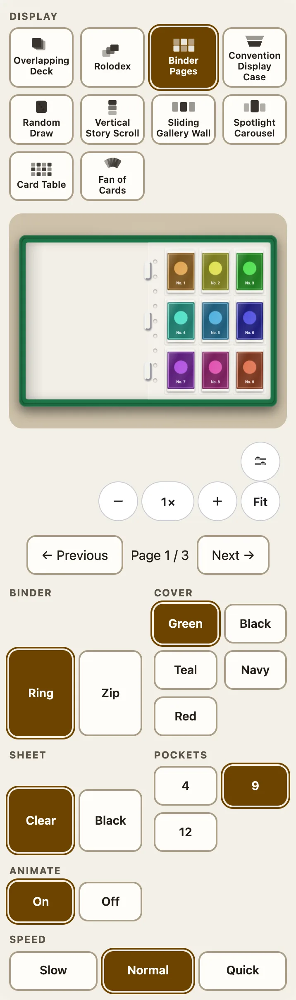
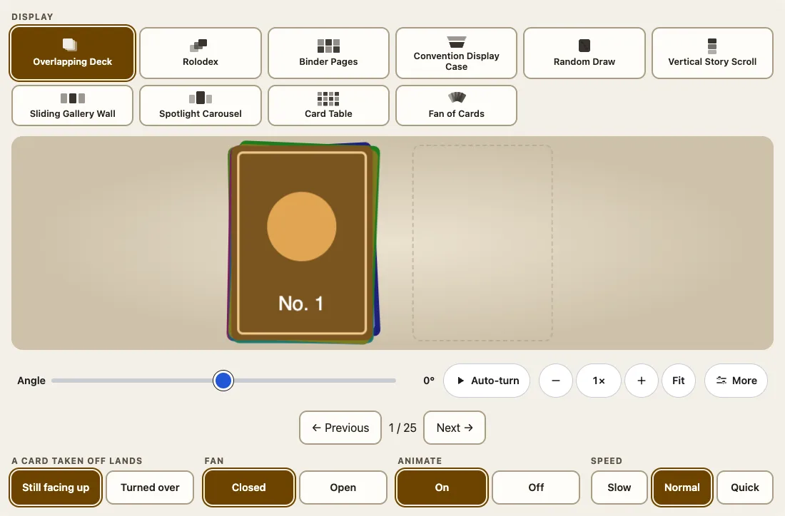
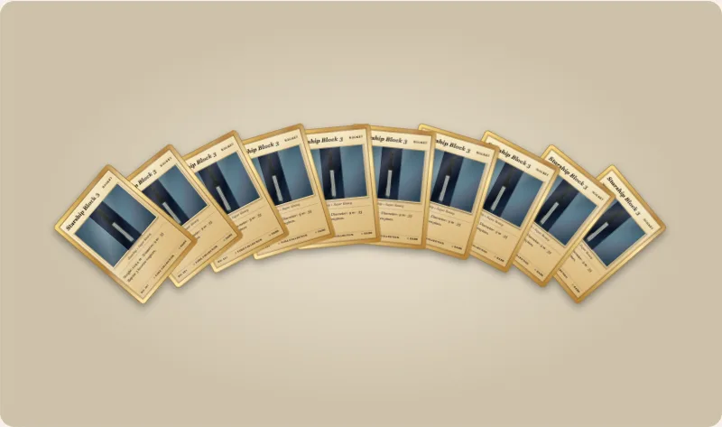

Two kinds of display show most of what a collector does: a **binder** open on two facing sheets of pockets, and a **pile** of cards that fans open and gives up one card at a time. The same code draws a pile in `<fuda-collection>` (the Overlapping Deck, Random Draw and the Fan of Cards) and in `<fuda-card stack>`.



## The binder

`view="binder"` is a binder open on two facing sheets. Each sheet is a page of clear plastic pockets with a slight sheen, one card to a pocket, on a clear or black sheet, with a strip of punched holes against the rings. Next and Previous turn the page: a leaf swings about the spine, bends as it goes and shows the pockets on its back.

```html
<fuda-collection view="binder" binder="zip" cover="navy" sheet="black" pockets="12"></fuda-collection>
<script type="module">
  import '@johnmorrisdotca/fuda-cards/collection-element';
  document.querySelector('fuda-collection').cards = Array.from({ length: 30 }, (_, i) => ({ name: `Card ${i + 1}`, image: `/cards/${i + 1}.jpg` }));
</script>
```

| Attribute | Values | Default |
|---|---|---|
| `binder` | `ring`, `zip` (a zipper and its pull) | `ring` |
| `cover` | `green`, `black`, `teal`, `navy`, `red` | `green` |
| `sheet` | `clear`, `black` | `clear` |
| `pockets` | `4` (2 by 2), `9` (3 by 3), `12` (4 across by 3 down) | `9` |

The older `page-size` and `columns` still work and set the pockets of a sheet. Each option is also a row of buttons under the view and a value in the address. Clicking a card opens it. With `animate="off"` or reduced motion the page changes at once and ends in exactly the same place.

## The deck, and every other pile

The Overlapping Deck (`view="deck"`) draws up to ten cards with a seeded, slightly messy lie (`deck-messiness` 0 to 1, default 0.3, and `deck-seed`) and, beside it, a pile. **Next** flips the top card off the deck: it lifts, flies across and lands on the pile at the deck's other side; **Previous** brings it back. Random Draw is a pile too, and the Fan of Cards is the same pile with only its fan. Rolodex and Spotlight spread their cards out; they are carousels, not piles.

Where a card lands is `deck-land`: `face-up` (the default) keeps it facing up, `face-down` turns it over sideways about its vertical axis, like turning a page, so the pile shows the card's `backImage` or the package's own back. A card never lands with its picture on its head. The 0.6.0 value `upside-down` is still accepted and means `face-down`.

```ts
import { deckLandings, fanLayout, normalizeLanding } from '@johnmorrisdotca/fuda-cards/collection';

console.log(deckLandings.map((landing) => landing.id).join(' '));
console.log(normalizeLanding('upside-down'), normalizeLanding('anything else'));
const fan = fanLayout(3);
console.log(fan.map((place) => place.angle).join(' '));
// face-up face-down
// face-down face-up
// -11 0 11
```



## Fan a pile, take a card off it

`fan="open"` spreads up to ten cards in an arc, like a hand of playing cards, with most of each card showing, and closes back exactly where they began. A card can be taken off an open fan and off a pile that was fanned and closed. In a collection the buttons are right under the view and the fan is in the address (`?fan=open`); `view="fan"` is the same pile with only its fan, `fan-size` (2 to 10) cards from the current one, and Next moves the window on.

On a card, a stack is a pile:

```html
<script type="module">import '@johnmorrisdotca/fuda-cards/element';</script>
<fuda-card id="pile" title="Deck" stack="52" pile-controls></fuda-card>
<script type="module">
  const pile = document.querySelector('#pile');
  pile.addEventListener('fuda-pile', (event) => console.log('reach', event.detail));
  pile.takeOff(3);
  pile.putBack();
</script>
```

- `taken-off="3"` puts the top three cards on a pile at the side, as thick as the cards in it. `card.takeOff(count)` and `card.putBack(count)` change it.
- `pile-controls` draws three buttons (Fan, Take a card off, Put it back), each at least 48 px; leave about 70 px of room below the card.
- `card.pileBounds` says how far an open fan or a side pile reaches beyond the card, in card widths; the event `fuda-pile` is sent when that changes, so your page can fit its view.
- The pile code is a separate module (`dist/pile-card.js`) that a card loads only when it asks for `fan`, `taken-off` or `pile-controls`. A plain card never requests it.



## Animate and speed

`animate="off"` turns every move off (each ends at once in exactly the same place) and `speed="slow"` or `"quick"` makes every move longer or shorter. `animate` is **on** when the attribute is missing. The moves are CSS transforms and one-shot animations that end by themselves, so nothing runs while the view is idle, and the reader's reduced-motion setting always wins. Both are under the view and in the address (`?animate=off&speed=quick`).

## Rotate a pile

A pile's view controls have the angle, tilt and Auto-turn (the flat displays do not), and the whole table, both piles, turns in 3D: from behind you see the backs of the deck and the faces of a face-down pile. Objects in a collection stay square to the reader. See [Collections](collections.md) for kinds.
