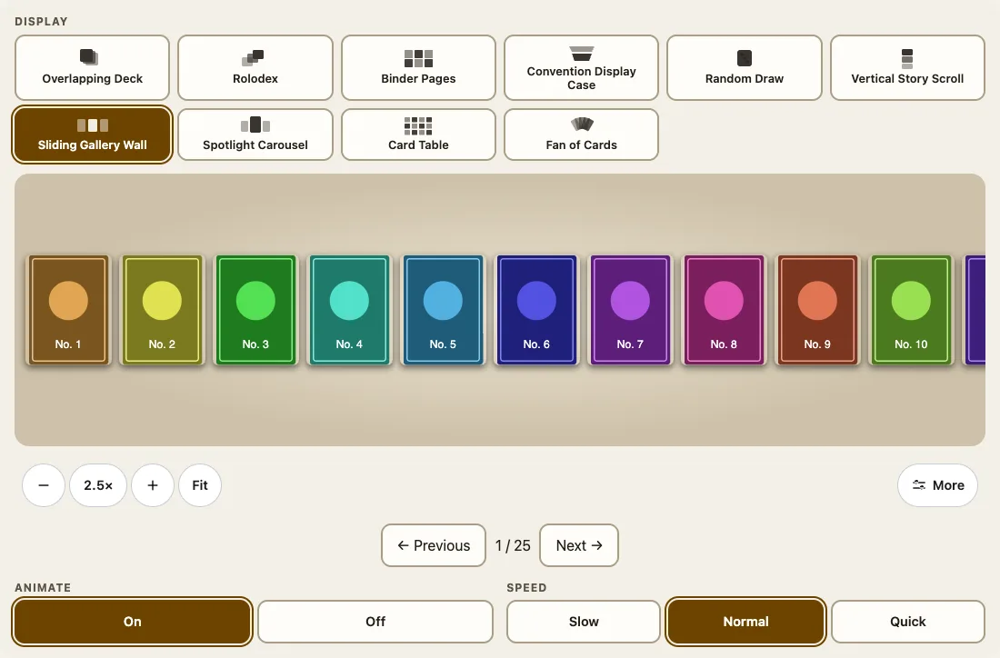
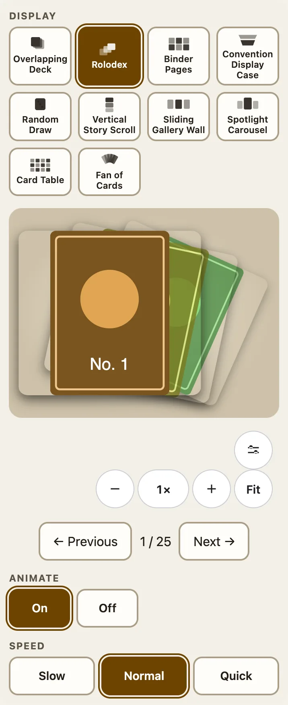

`<fuda-collection>` shows a list of items in one of ten displays and gives the reader a zoom bar, a choice of display and, where it makes sense, the options of that display. You supply the list; Fuda stores nothing, asks for no account and fetches nothing except the image addresses you give it.



## Give it cards

Import `@johnmorrisdotca/fuda-cards/collection-element` once, then set the `cards` **property** (an array cannot be an attribute):

```html
<fuda-collection view="wall" theme="light"></fuda-collection>
<script type="module">
  import '@johnmorrisdotca/fuda-cards/collection-element';
  document.querySelector('fuda-collection').cards = [
    { id: 'a', name: 'Alpha', image: '/cards/alpha.jpg', backImage: '/cards/alpha-back.jpg' },
    { id: 'b', name: 'Bravo', image: '/cards/bravo.jpg', metadata: { set: 'Base', year: 1999, number: '2' } },
    { id: 'c', name: 'Console', image: '/cards/console.jpg', kind: 'object' },
  ];
</script>
```

The input may be an array or an object with a `cards` array. Each item needs a `name` and an `image` URL. `id` is optional (the position is used), and must be unique. `backImage` is optional; without one the package draws its own navy back.

## Check a list first

`parseCollection` is the check the element runs, exported so you can run it on a file before you hand it over. It returns the normalised list or throws an `Error` that names the item.

```ts
import { collectionKinds, collectionViews, isCard, parseCollection, randomDrawIndex } from '@johnmorrisdotca/fuda-cards/collection';

const cards = parseCollection({ cards: [
  { name: 'Alpha', image: '/a.jpg' },
  { id: 'console', name: 'Console', image: '/c.jpg', kind: 'object' },
] });
console.log(cards.map((card) => `${card.id}:${isCard(card)}`).join(' '));
console.log(collectionKinds.join(' '), collectionViews.length);
console.log(randomDrawIndex(cards, 0, 'cons', () => 0));
try { parseCollection([{ name: 'No picture' }]); } catch (error) { console.log((error as Error).message); }
// 0:true console:false
// card object 10
// 1
// Card 1 needs a name and image URL.
```

`randomDrawIndex(cards, current, filter, random?)` picks a card whose name contains the filter, avoiding the current one when another matches, and gives `null` when none matches. `movePage(index, length, pageSize, delta)` returns the first index of the page `delta` pages away, wrapping round.

## Kinds

`kind` says what an item is: `"card"` (the default, so every collection written before the field existed is still cards) or `"object"`. A card is flat and thin with a back, so it turns in 3D, can be seen from behind and lands turned over when taken off a pile. An object is a picture of a thing that is not a card, such as a games console: it has no back and no thickness, so it never turns over and always lands facing up. A collection with no card in it offers no Angle, Tilt or Auto-turn, and drops an angle from the address. In a mixed collection the controls are there for the cards and each object stays square to the reader. Objects can still be fanned open and taken off a pile.

## Metadata

`metadata` is optional and has `set`, `number`, `edition`, `condition`, `grade` and `notes` (strings), and `year` and `quantity` (whole numbers, `quantity` at least 1). Nothing assumes a price or a grade.

## The ten displays

| `view` | Display | Kind of display |
|---|---|---|
| `deck` | Overlapping Deck | a pile, with a pile beside it |
| `rolodex` | Rolodex | a carousel |
| `binder` | Binder Pages | sheets of pockets |
| `case` | Convention Display Case | cards on a ledge |
| `random` | Random Draw | a pile; the draw button takes a name filter |
| `story` | Vertical Story Scroll | a column |
| `wall` | Sliding Gallery Wall | a row on a wall |
| `spotlight` | Spotlight Carousel | one card lit, its neighbours around it |
| `atlas` | Card Table | all the cards on a plane |
| `fan` | Fan of Cards | a hand |



`jukebox` and `tower` were dropped in 0.8.0; they still open the deck (`collectionViewAliases`). The binder and case take `page-size` (1 to 100 cards) and `columns` (1 to 10; at most two on a small screen). The reader chooses the display with a row of buttons across the top: a radio group with one tab stop and the arrow keys.

## The address and theme

Add the boolean `address` attribute and the zoom, the display, the fan, the landing, Animate and Speed are kept in the page address (`?view=fan&fan=open&land=face-down&zoom=2`), so a link opens the same view. `theme="light"` or `theme="dark"` fixes the colours; without it they follow the reader. `--fuda-stage-height` sets the height of the view (default: the window less 440 px, between 300 and 620 px) so the controls stay on the first screen.

## Live 3D in a collection

`collection.live = { cards: live, item: (card) => itemFor(card) }` makes the card in focus turn in 3D on every display: see [Live 3D in a card](live-3d.md). For the piles and the binder in detail, see [Binders and piles](binder-and-piles.md).
