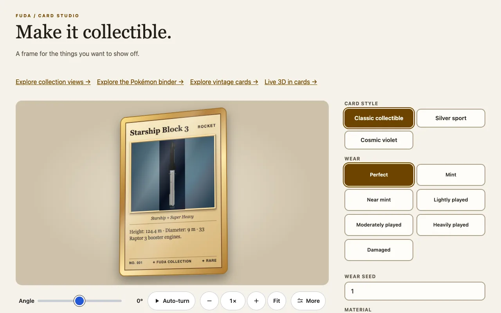
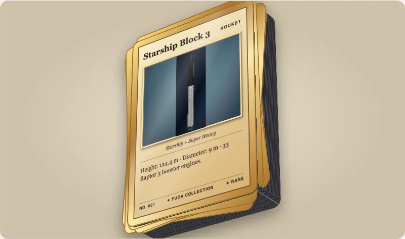
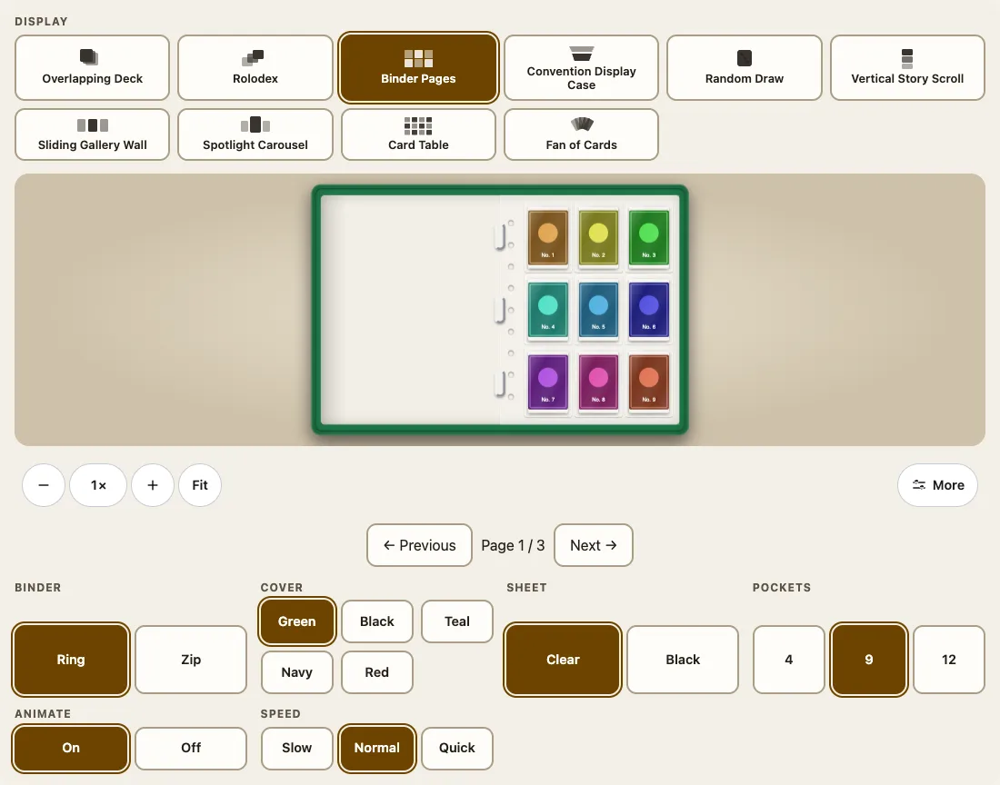

Fuda Cards draws collectible cards as web components. A card is a frame around a picture you give it; a collection is a whole shelf of them. Nothing needs a framework or a 3D engine. This guide takes you from an empty page to a card, a stack of cards and a binder.



## Install

```sh
npm install @johnmorrisdotca/fuda-cards
```

The package is plain ES modules in `dist/`. It has one runtime dependency, [`@johnmorrisdotca/kazoku-ui`](https://github.com/johnmorrisdotca/kazoku-ui), which draws the zoom bar of the collection viewer. A single card needs nothing else.

## Your first card

Import the element once, then write the tag. The picture goes inside it, as a child.

```html
<script type="module">
  import '@johnmorrisdotca/fuda-cards/element';
</script>
<fuda-card title="Explorer One" category="ROCKET" variant="cosmic" finish="foil" description="A new explorer.">
  
</fuda-card>
```

`variant` is `classic`, `sport` or `cosmic`; `finish` is `foil` or `matte`. The card is 300 px wide by default and keeps the 2.5 by 3.5 proportion of a real card: set the element's `width` in CSS to scale it, and everything inside scales with it.

On a page with no bundler, replace the bare name with the path of `dist/element.js` and serve the whole `dist` folder, or add an import map (see [Frameworks and bundlers](frameworks.md)).

## Turn it over and give it thickness

A card has two faces and an edge. `flipped` shows the back; `thickness` is in millimetres and drawn to scale.

```html
<script type="module">import '@johnmorrisdotca/fuda-cards/element';</script>
<fuda-card title="Relic" thickness="1.5" flipped></fuda-card>
```

## A stack, and a card that has been used

`stack` draws that many cards, as high as the count times the card's thickness. `material` takes the thickness of a real card stock. `wear` marks a card as played.

```html
<script type="module">import '@johnmorrisdotca/fuda-cards/element';</script>
<fuda-card title="Deck" material="paper-310-black-core" stack="52" stack-messiness="0.3" stack-seed="7"></fuda-card>
<fuda-card title="Rookie" wear="moderately-played" wear-seed="7"></fuda-card>
```



The numbers in `stack` and the words in `material` and `wear` come from tables the package exports as data, so you can build your own menu from them:

```ts
import { cardMaterial, stackHeightMm, wearPresets } from '@johnmorrisdotca/fuda-cards';

const material = cardMaterial('paper-310-black-core');
console.log(material?.thicknessMm, stackHeightMm(52, material?.thicknessMm ?? 0.3));
console.log(wearPresets.map((preset) => preset.id).join(' '));
// 0.325 16.9
// perfect mint near-mint lightly-played moderately-played heavily-played damaged
```

## A collection

`<fuda-collection>` takes a list of items in its `cards` property (a property, not an attribute) and shows them in one of ten displays.

```html
<fuda-collection view="binder"></fuda-collection>
<script type="module">
  import '@johnmorrisdotca/fuda-cards/collection-element';
  document.querySelector('fuda-collection').cards = [
    { id: 'one', name: 'First card', image: '/cards/one.jpg', backImage: '/cards/one-back.jpg' },
    { id: 'two', name: 'Second card', image: '/cards/two.jpg' },
  ];
</script>
```



Change `view` to `deck`, `rolodex`, `case`, `random`, `story`, `wall`, `spotlight`, `atlas` or `fan` to see the others; [Collections](collections.md) lists them all.

## Where to go next

- Every attribute of the card: [The card element](card-element.md).
- Why the page must not flash a raw picture before the card appears: [Troubleshooting](troubleshooting.md#the-picture-flashes-before-the-card-appears).
- How the package is built and why: [Architecture](architecture.md).
- The demos, to try each option with your eyes: the [Card Studio](https://johnmorrisdotca.github.io/fuda-cards/).
