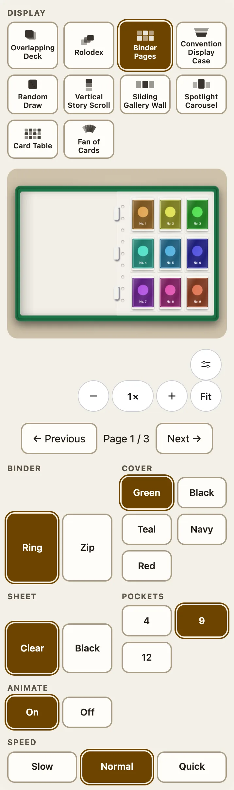
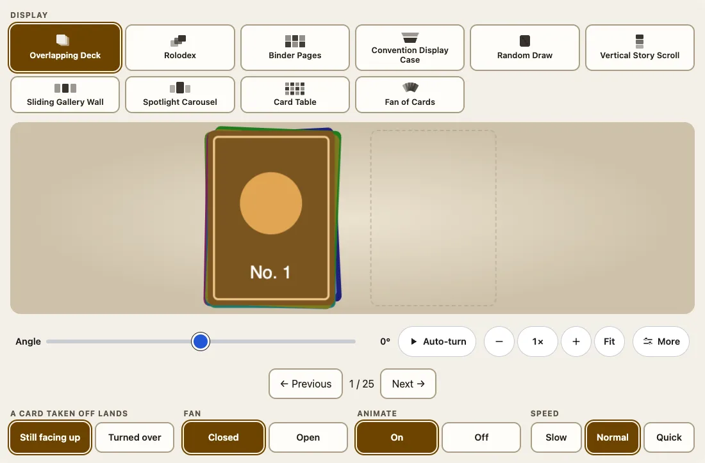
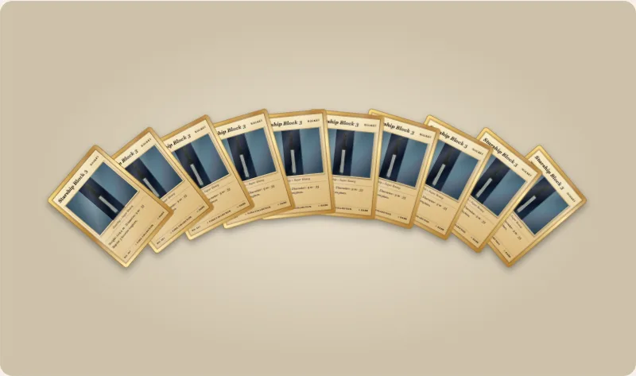

収集家のすることの大半は、2種類の表示で見せられます。2枚のシートが向かい合って開く**バインダー**と、扇状に開いて1枚ずつカードを取り出せる**山**です。山は、`<fuda-collection>`（重ねたデッキ、ランダムに引く、カードの扇）でも、`<fuda-card stack>`でも、同じコードで描かれます。



## バインダー

`view="binder"`は、2枚のシートが向かい合って開いたバインダーです。各シートは、わずかに光沢のある透明なポケットが並ぶページで、ポケット1つにカード1枚が入ります。シートは透明か黒で、リング側には穴の列があります。次へ・前へでページがめくれます。1枚のページが綴じ目を軸に振れ、曲がりながら動いて、裏側のポケットが見えます。

```html
<fuda-collection view="binder" binder="zip" cover="navy" sheet="black" pockets="12"></fuda-collection>
<script type="module">
  import '@johnmorrisdotca/fuda-cards/collection-element';
  document.querySelector('fuda-collection').cards = Array.from({ length: 30 }, (_, i) => ({ name: `Card ${i + 1}`, image: `/cards/${i + 1}.jpg` }));
</script>
```

| 属性 | 値 | 初期値 |
|---|---|---|
| `binder` | `ring`、`zip`（ファスナーとつまみ付き） | `ring` |
| `cover` | `green`、`black`、`teal`、`navy`、`red` | `green` |
| `sheet` | `clear`、`black` | `clear` |
| `pockets` | `4`（2×2）、`9`（3×3）、`12`（横4×縦3） | `9` |

以前からの`page-size`と`columns`も使え、1枚のシートのポケット数を決めます。各設定は、表示の下のボタンの列にもあり、URLにも入ります。カードをクリックすると開きます。`animate="off"`や動きの軽減のときは、ページが即座に変わり、最後は同じ状態になります。

## デッキと、ほかのすべての山

重ねたデッキ（`view="deck"`）は、最大10枚のカードを、シードで決まる少し乱れた並びで描き（`deck-messiness`は0から1で初期値0.3、`deck-seed`）、その脇に山を置きます。**次へ**で一番上のカードがデッキから離れます。持ち上がり、横切って飛び、デッキの反対側の山に着地します。**前へ**で戻ります。「ランダムに引く」も山で、「カードの扇」は扇だけを見せる同じ山です。ロロデックスとスポットライトはカードを広げて見せるカルーセルで、山ではありません。

カードの着地は`deck-land`で決まります。`face-up`（初期値）は表向きのまま、`face-down`は縦軸を中心に横向きに、ページをめくるように裏返り、山にはカードの`backImage`かパッケージ自前の裏面が見えます。絵が逆さまになって着地することはありません。0.6.0の値`upside-down`も今まで通り受け付けられ、`face-down`と同じ意味です。

```ts
import { deckLandings, fanLayout, normalizeLanding } from '@johnmorrisdotca/fuda-cards/collection';

console.log(deckLandings.map((landing) => landing.id).join(' '));
console.log(normalizeLanding('upside-down'), normalizeLanding('anything else'));
const fan = fanLayout(3);
console.log(fan.map((place) => place.angle).join(' '));
// face-up face-down
// face-down face-up
// -11 0 11
```



## 山を扇状に開く、1枚取り出す

`fan="open"`は最大10枚を、トランプの手札のように弧状に広げ、それぞれのカードの大部分が見えるようにして、閉じるときは始めの位置にぴったり戻ります。開いた扇からも、扇を開いて閉じた山からも、カードを取り出せます。コレクションでは、ボタンは表示のすぐ下にあり、扇はURLに入ります（`?fan=open`）。`view="fan"`は扇だけを見せる同じ山で、現在のカードから`fan-size`枚（2から10）を扇にし、次へで扇にする範囲が先へ進みます。

`<fuda-card>`では、`stack`が山の役目を果たします。

```html
<script type="module">import '@johnmorrisdotca/fuda-cards/element';</script>
<fuda-card id="pile" title="Deck" stack="52" pile-controls></fuda-card>
<script type="module">
  const pile = document.querySelector('#pile');
  pile.addEventListener('fuda-pile', (event) => console.log('reach', event.detail));
  pile.takeOff(3);
  pile.putBack();
</script>
```

- `taken-off="3"`は、一番上の3枚を脇の山に移します。山の厚みは、中のカードの枚数分です。`card.takeOff(count)`と`card.putBack(count)`でも変えられます。
- `pile-controls`は、3つのボタン（扇、1枚取り出す、戻す）を描きます。どれも48 px以上で、カードの下に約70 pxの余白を残してください。
- `card.pileBounds`は、開いた扇や脇の山がカードの外へ広がる距離をカード幅で示します。変わると`fuda-pile`イベントが送られるので、ページ側が表示に合わせられます。
- 山のコードは別のモジュール（`dist/pile-card.js`）で、カードが`fan`、`taken-off`、`pile-controls`を求めたときだけ読み込まれます。ふつうのカードはこれを要求しません。



## Animateとspeed

`animate="off"`ですべての動きがなくなり（どれも即座に、まったく同じ位置で終わります）、`speed="slow"`か`"quick"`で、すべての動きが長くなる、または短くなります。`animate`は、属性がないときは**オン**です。動きはCSSの変形と、自分で終わる1回きりのアニメーションなので、表示が静止している間は何も動いておらず、閲覧者の動きの軽減の設定が常に優先されます。どちらも表示の下とURLにあります（`?animate=off&speed=quick`）。

## 山を回す

山の表示操作には、角度、傾き、自動回転があります（平らな表示にはありません）。そして、2つの山を含むテーブル全体が3Dで回り、後ろからはデッキの裏面と、裏返した山の表面が見えます。コレクションの中のオブジェクトは閲覧者に正対したままです。種類については[コレクション](collections.md)を参照してください。
