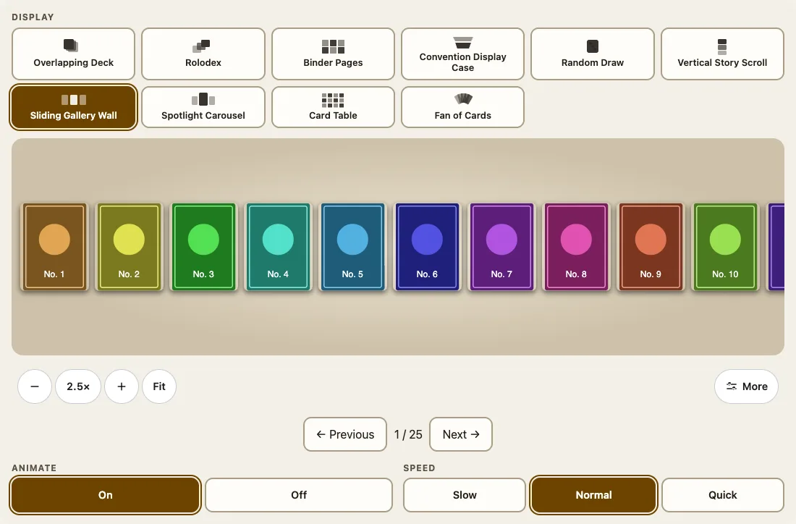
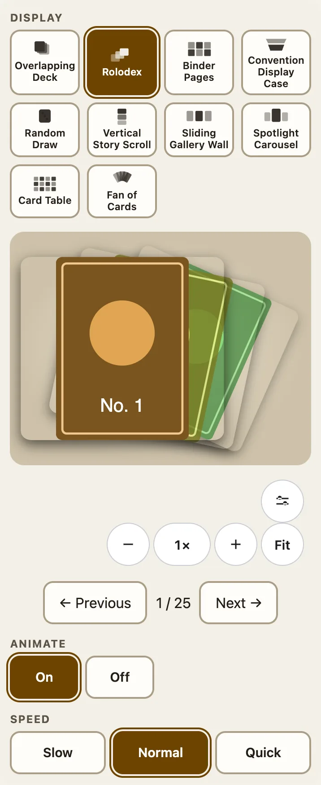

`<fuda-collection>`は、渡した一覧を10種類の表示のどれかで見せ、閲覧者にズームバー、表示の選択、そして表示ごとの設定を用意します。一覧を用意するのは利用側で、Fudaは何も保存せず、アカウントも求めず、指定された画像のURL以外は何も取得しません。



## カードを渡す

`@johnmorrisdotca/fuda-cards/collection-element`を1回インポートし、`cards`**プロパティ**を設定します（配列は属性にできません）。

```html
<fuda-collection view="wall" theme="light"></fuda-collection>
<script type="module">
  import '@johnmorrisdotca/fuda-cards/collection-element';
  document.querySelector('fuda-collection').cards = [
    { id: 'a', name: 'Alpha', image: '/cards/alpha.jpg', backImage: '/cards/alpha-back.jpg' },
    { id: 'b', name: 'Bravo', image: '/cards/bravo.jpg', metadata: { set: 'Base', year: 1999, number: '2' } },
    { id: 'c', name: 'Console', image: '/cards/console.jpg', kind: 'object' },
  ];
</script>
```

入力は配列か、`cards`配列を持つオブジェクトです。各項目には`name`と`image`のURLが必要です。`id`は省略でき（省略すると位置が使われます）、重複はできません。`backImage`は任意で、なければパッケージ自前の紺色の裏面が使われます。

## 先に一覧を検査する

`parseCollection`は、要素が実行する検査と同じもので、ファイルを渡す前に自分で実行できるように公開されています。正規化した一覧を返すか、問題の項目を示す`Error`を投げます。

```ts
import { collectionKinds, collectionViews, isCard, parseCollection, randomDrawIndex } from '@johnmorrisdotca/fuda-cards/collection';

const cards = parseCollection({ cards: [
  { name: 'Alpha', image: '/a.jpg' },
  { id: 'console', name: 'Console', image: '/c.jpg', kind: 'object' },
] });
console.log(cards.map((card) => `${card.id}:${isCard(card)}`).join(' '));
console.log(collectionKinds.join(' '), collectionViews.length);
console.log(randomDrawIndex(cards, 0, 'cons', () => 0));
try { parseCollection([{ name: 'No picture' }]); } catch (error) { console.log((error as Error).message); }
// 0:true console:false
// card object 10
// 1
// Card 1 needs a name and image URL.
```

`randomDrawIndex(cards, current, filter, random?)`は、名前にフィルターの文字を含むカードから1枚を選び、ほかに一致があるときは現在のカードを避けます。一致がなければ`null`です。`movePage(index, length, pageSize, delta)`は、`delta`ページ先のページの最初の位置を返し、端では回り込みます。

## 種類

`kind`は項目が何かを表し、`"card"`（初期値。この項目ができる前に書かれたコレクションも、すべてカードとして扱われます）か`"object"`です。カードは平らで薄く裏があるので、3Dで回り、後ろから見え、山から取り出すと裏返しで着地します。オブジェクトは、ゲーム機のようなカードではないものの画像で、裏も厚みもないので、裏返ることはなく、いつも表向きに着地します。カードを1枚も含まないコレクションでは、角度、傾き、自動回転は出ず、URLにも角度が含まれません。混在するコレクションでは、操作はカードのためにあり、オブジェクトは閲覧者に正対したままです。オブジェクトも、扇状に開くことや山から取り出すことはできます。

## メタデータ

`metadata`は任意で、`set`、`number`、`edition`、`condition`、`grade`、`notes`（文字列）と、`year`、`quantity`（整数。`quantity`は1以上）を持てます。価格や評価があるとは仮定しません。

## 10種類の表示

| `view` | 表示 | 表示の種類 |
|---|---|---|
| `deck` | 重ねたデッキ | 山と、その脇にもう1つの山 |
| `rolodex` | ロロデックス | カルーセル |
| `binder` | バインダーのページ | ポケット付きのシート |
| `case` | 展示ケース | 台に並べたカード |
| `random` | ランダムに引く | 山。引くボタンは名前で絞り込める |
| `story` | 縦スクロール | 1列 |
| `wall` | スライドするギャラリーウォール | 壁に並ぶ1行 |
| `spotlight` | スポットライト・カルーセル | 1枚が照らされ、周りに隣のカード |
| `atlas` | カードテーブル | すべてのカードを1つの平面に並べる |
| `fan` | カードの扇 | 手札 |



`jukebox`と`tower`は0.8.0で廃止されましたが、今もデッキ表示として開きます（`collectionViewAliases`）。バインダーとケースは`page-size`（1から100枚）と`columns`（1から10。小さい画面では最大2）を受け付けます。表示は、閲覧者が上部のボタンの列で選びます。タブ停止が1つで矢印キーで選択が動くラジオグループです。

## URLとテーマ

真偽値の`address`属性を付けると、ズーム、表示、扇、着地、Animate、SpeedがページのURLに保存され（`?view=fan&fan=open&land=face-down&zoom=2`）、リンクを開くと同じ表示になります。`theme="light"`か`theme="dark"`で配色を固定でき、指定がなければ閲覧者の設定に従います。`--fuda-stage-height`は表示の高さを決め（初期値はウィンドウの高さから440 pxを引いた値で、300から620 pxの間）、操作が最初の画面に収まるようにします。

## コレクションでのライブ3D

`collection.live = { cards: live, item: (card) => itemFor(card) }`と設定すると、どの表示でも、フォーカスされたカードが3Dで回ります。[カード内のライブ3D](live-3d.md)を参照してください。山とバインダーの詳細は[バインダーと山](binder-and-piles.md)にあります。
