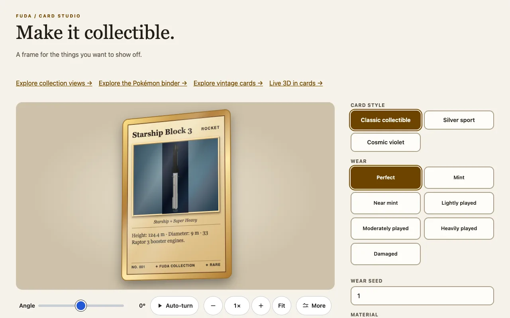
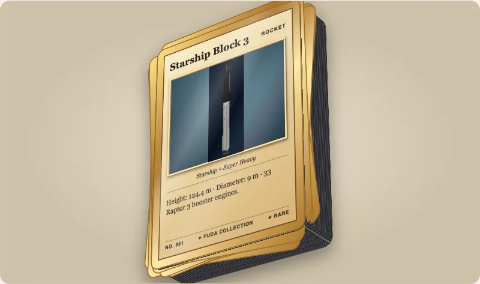
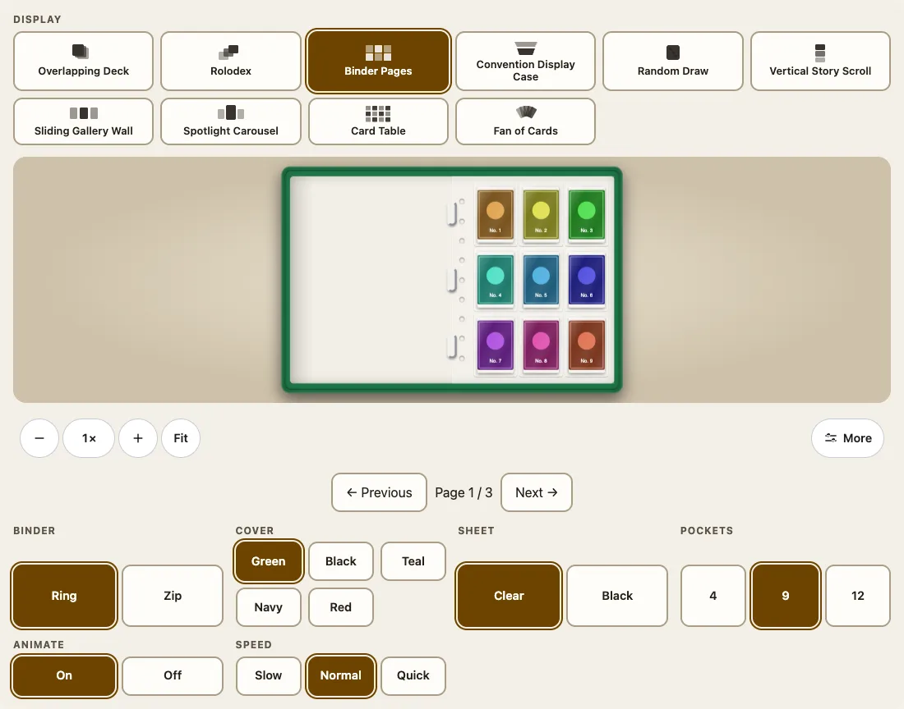

Fuda Cardsは、コレクション用のカードをWebコンポーネントとして描きます。カードは渡した画像を囲む枠で、コレクションはカードを並べた棚です。フレームワークも3Dエンジンも要りません。このガイドでは、空のページからカード、カードの山、バインダーまでを順に作ります。



## インストール

```sh
npm install @johnmorrisdotca/fuda-cards
```

パッケージは`dist/`にあるふつうのESモジュールです。実行時の依存は[`@johnmorrisdotca/kazoku-ui`](https://github.com/johnmorrisdotca/kazoku-ui)が1つだけで、コレクションのズームバーを描くために使います。カード1枚だけなら、ほかに何も要りません。

## 最初のカード

要素を1回インポートしてから、タグを書きます。画像は子要素として中に入れます。

```html
<script type="module">
  import '@johnmorrisdotca/fuda-cards/element';
</script>
<fuda-card title="Explorer One" category="ROCKET" variant="cosmic" finish="foil" description="A new explorer.">
  
</fuda-card>
```

`variant`は`classic`、`sport`、`cosmic`のいずれか、`finish`は`foil`か`matte`です。カードの幅は初期値で300 pxで、本物のカードと同じ2.5対3.5の比率を保ちます。CSSで要素の`width`を変えると、中身もいっしょに拡大・縮小します。

バンドラーを使わないページでは、パッケージ名だけのインポートを`dist/element.js`のパスに置き換えて`dist`フォルダー全体を配信するか、インポートマップを使います（[フレームワークとバンドラー](frameworks.md)を参照）。

## 裏返す、厚みを持たせる

カードには表と裏と縁があります。`flipped`で裏を見せ、`thickness`はミリメートルで、実寸の比率で描かれます。

```html
<script type="module">import '@johnmorrisdotca/fuda-cards/element';</script>
<fuda-card title="Relic" thickness="1.5" flipped></fuda-card>
```

## カードの山と、使い込んだカード

`stack`は指定した枚数のカードを、枚数に1枚の厚みをかけた高さの山として描きます。`material`は実際のカード用紙などの厚みを使います。`wear`はカードを使い込んだ状態にします。

```html
<script type="module">import '@johnmorrisdotca/fuda-cards/element';</script>
<fuda-card title="Deck" material="paper-310-black-core" stack="52" stack-messiness="0.3" stack-seed="7"></fuda-card>
<fuda-card title="Rookie" wear="moderately-played" wear-seed="7"></fuda-card>
```



`stack`の枚数、`material`と`wear`の名前は、パッケージがデータとして公開している表から来ています。自分のメニューをそこから作れます。

```ts
import { cardMaterial, stackHeightMm, wearPresets } from '@johnmorrisdotca/fuda-cards';

const material = cardMaterial('paper-310-black-core');
console.log(material?.thicknessMm, stackHeightMm(52, material?.thicknessMm ?? 0.3));
console.log(wearPresets.map((preset) => preset.id).join(' '));
// 0.325 16.9
// perfect mint near-mint lightly-played moderately-played heavily-played damaged
```

## コレクション

`<fuda-collection>`は、`cards`**プロパティ**（属性ではありません）に渡した一覧を、10種類の表示のどれかで見せます。

```html
<fuda-collection view="binder"></fuda-collection>
<script type="module">
  import '@johnmorrisdotca/fuda-cards/collection-element';
  document.querySelector('fuda-collection').cards = [
    { id: 'one', name: 'First card', image: '/cards/one.jpg', backImage: '/cards/one-back.jpg' },
    { id: 'two', name: 'Second card', image: '/cards/two.jpg' },
  ];
</script>
```



`view`を`deck`、`rolodex`、`case`、`random`、`story`、`wall`、`spotlight`、`atlas`、`fan`に変えると、ほかの表示になります。一覧は[コレクション](collections.md)にあります。

## 次に読むもの

- カードのすべての属性：[カード要素](card-element.md)
- カードが現れる前に元の画像がちらつかないようにする方法：[困ったとき・よくある質問](troubleshooting.md#カードが現れる前に画像がちらつく)
- パッケージの作りと理由：[アーキテクチャ](architecture.md)
- 各設定を目で試せるデモ：[カードスタジオ](https://johnmorrisdotca.github.io/fuda-cards/)
