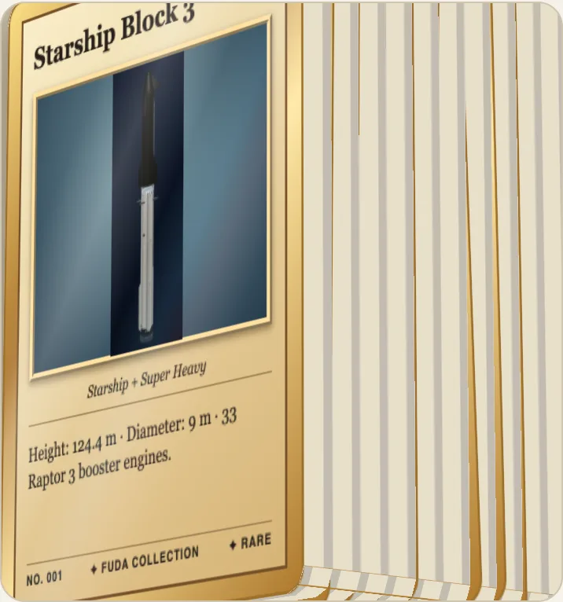
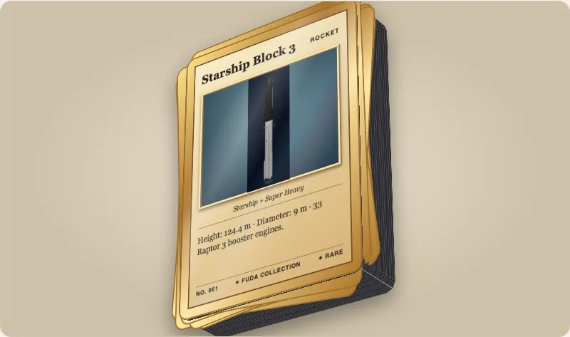

Fudaのカードには厚みがあり、カードの山の高さは、枚数にカード1枚の厚みをかけたものになります。どちらも幅63 mmのカードの大きさを基準に実寸の比率で描かれるので、52枚のデッキは52枚分の高さに見えます。



## 厚み

`thickness`はミリメートルです。初期値は`0.325`（トランプの黒芯用紙、13 pt。`DEFAULT_CARD_THICKNESS_MM`として公開）で、`0`は平らなカードです。`material`を指定すると、実際の用紙の厚みと縁の色が使われます。`thickness`を併せて指定すると、そちらが優先されます。

```html
<script type="module">import '@johnmorrisdotca/fuda-cards/element';</script>
<fuda-card title="Thin" thickness="0.3"></fuda-card>
<fuda-card title="Trading card, 130 pt" material="card-130pt"></fuda-card>
<fuda-card title="Metal" material="steel-0.5"></fuda-card>
```

素材の厚みはすべて、メーカーのページまたは規格から読み取ったもので、[docs/materials.md](../../materials.md)の表に出典と引用があります（英語）。IDは4つのグループに分かれます。カード用紙の`paper-250`、`paper-310-black-core`、`paper-350`、銀行カードサイズの`plastic-id1`、厚手のトレーディングカードの`card-35pt`から`card-180pt`と`booklet-175pt`、金属の`aluminium-0.8`と`steel-0.5`です。コードからも読めます。

```ts
import { cardMaterials, mmPerPoint } from '@johnmorrisdotca/fuda-cards';

const thick = cardMaterials.filter((material) => material.group === 'thick-card');
console.log(thick.length, thick[0].id, thick[0].thicknessMm);
console.log(130 * mmPerPoint);
// 7 card-35pt 0.889
// 3.302
```

縁の色は見た目の設定で、測定値ではありません。好みの色にするには、カードに`--fuda-edge`を指定します。任意のCSS背景が使えます。

## 山

`stack="52"`は52枚のカードを描きます。一番上は実際のカード要素で、その下のかたまりは、カード1枚ごとに細い線を引いた1つのブロックです。枚数は自由で、1から1000です。

```html
<script type="module">import '@johnmorrisdotca/fuda-cards/element';</script>
<fuda-card title="Deck" material="paper-310-black-core" stack="52" stack-messiness="0.6" stack-seed="7" stack-depth="10"></fuda-card>
```

| 属性 | 範囲 | 初期値 | 意味 |
|---|---|---|---|
| `stack` | 1から1000 | 1 | カードの枚数。 |
| `stack-messiness` | 0から1 | 0.3 | 0は揃っている、1はとても乱れている。 |
| `stack-seed` | 整数 | 1 | 同じシードなら、同じ山が同じように積まれる。 |
| `stack-depth` | 0から52 | 10 | 一番上の下にあるカードのうち、少しずらして回した状態で並べる枚数。 |

山の上にカードを1枚足しても、下のカードは動きません。各カードの位置は、下から数えた番号で決まるからです。一番上の下にあるカードは文字も絵もない平らな静止画で、52枚の山の描画量は11枚の山と変わりません。山は静止中は何も描かず、52枚の山がフレームを要求しないことをテストで確かめています。

`stackPresets`は出典のある4つの枚数です。トランプ2種類（52枚と54枚）、ポケモンのデッキ60枚、ブースターパック10枚です。ページにカードを置かなくても、山の高さを計算できます。

```ts
import { cardMaterial, DEFAULT_CARD_THICKNESS_MM, stackHeightMm, stackLayout, stackPresets } from '@johnmorrisdotca/fuda-cards';

const stock = cardMaterial('paper-310-black-core');
console.log(stackHeightMm(52, stock?.thicknessMm ?? DEFAULT_CARD_THICKNESS_MM));
console.log(stackPresets.map((preset) => preset.count).join(' '));
console.log(stackLayout(5, { messiness: 0, seed: 1 }).length);
// 16.9
// 52 54 60 10
// 4
```



## スクリプトから山を読む

`card.stackCount`と`card.stackHeight`（ミリメートル）は読み取り専用です。山を扇状に開いたりカードを取り出したりするには、[バインダーと山](binder-and-piles.md)を参照してください。きれいから乱れまでの山という考え方は、[toranpu](https://github.com/johnmorrisdotca/toranpu)から来ています。
