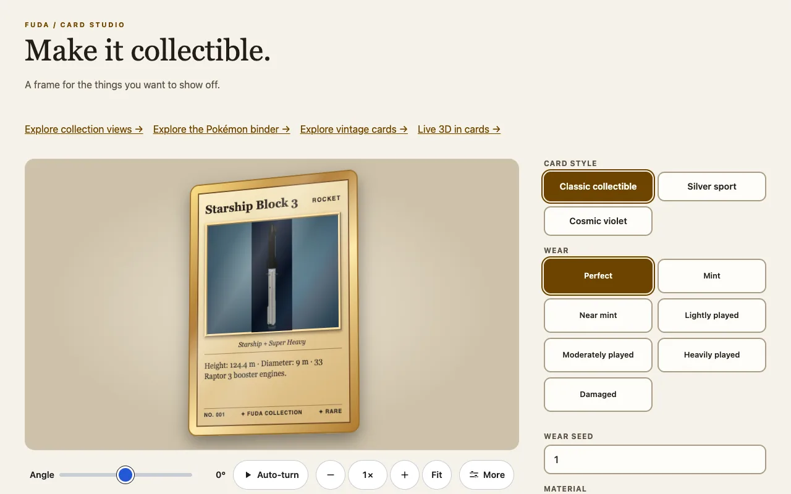

カードの上で動くものは3つあり、互いに独立しています。**画像**はパンでき、**カード**は回転でき、カードは**裏返せます**（`flipped`。[カード要素](card-element.md)を参照）。閲覧者のシステムが動きの軽減を求めている場合は、どれも止まります。

## 画像を動かす

スロットに``を入れたカードに`motion="pan"`を付けると、縦長の画像でAnimateボタンが使えます。ボタンは画像の角にある小さな再生・一時停止の印で、ポインターを重ねるかフォーカスするまでは薄く描かれます。タップやクリックできる範囲は48 px四方、アクセシブルな名前は「Animate the picture」で、動いているかどうかは`aria-pressed`が示します。

```html
<script type="module">import '@johnmorrisdotca/fuda-cards/element';</script>
<fuda-card title="Starship" motion="pan" pan-direction="down" style="--fuda-pan-duration: 16s">
  
</fuda-card>
```

| 属性・プロパティ | 意味 |
|---|---|
| `motion="pan"` | パンを許可し、ボタンを表示する。 |
| `playing` | 動き始める。ホストが付け外しでき、ボタンで切り替わる。 |
| `pan-direction` | `down`（初期値）、または下から始まる`up`。 |
| `pan-loop` | `alternate`（初期値、往復）、または`restart`。 |
| `--fuda-pan-duration` | 1回の移動の時間。`16s`のようなCSSの時間。 |
| `--fuda-focus-x`、`--fuda-focus-y` | 静止画で中心にする位置。`50%`と`20%`など。 |
| `moving` | 画像が動いている間、カードが付ける。スタイル用で、読み取り専用。代わりに`playing`か`autoplay`を設定する。 |

画像が幅いっぱいに広がったあとで、カードの表示枠より縦に長くなければ、動く距離がなく、パンしません。

## フォーカスしたときの自動再生

`autoplay="focus"`は、カードがフォーカスされている間、画像を自動で動かします。フォーカスされるカードは同時に1枚だけで、マウスポインターの下にあるカード、キーボードのフォーカスを持つカード（Tabでボタンへ）、タッチ画面では最後にタップしたカードです。フォーカスが移ると、前のカードは静止画に戻るので、行やグリッドの中で動くのは常に1枚だけです。ボタンは残り、押すと次にフォーカスされるまで一時停止します。`prefers-reduced-motion: reduce`のときは、自動再生は始まりません。

```html
<script type="module">import '@johnmorrisdotca/fuda-cards/element';</script>
<fuda-card title="Starship" motion="pan" autoplay="focus">
  
</fuda-card>
```

## カード全体を回す

`card-spin="center"`は、カード全体を縦の中心軸でゆっくり3Dで回します。`card-spin="corner"`はアイススケーターのように、左下の角を通る縦軸で1周します。その角は要素の中央で動かず、半周したところで裏が見えます。角を軸にした回転は、その点の両側へ大きく振れるので、余白を取ってください。ステージは、カードの幅の約3倍、高さの約2倍が目安です。

```html
<script type="module">import '@johnmorrisdotca/fuda-cards/element';</script>
<fuda-card title="Explorer" card-spin="center" style="--fuda-card-spin-duration: 30s"></fuda-card>
<fuda-card title="Skater" card-spin="corner" card-spin-direction="reverse" card-spin-paused></fuda-card>
```

初期値は180秒で1周です。`--fuda-card-spin-duration`には正のCSS時間を指定します。`card-spin-direction="reverse"`で逆回転、`card-spin-paused`でその角度に一時停止（外すと再開）、`card-spin`を外すと止まって元に戻ります。

## 回転を自分で動かす

真偽値の`card-view`属性を付けると、内蔵のアニメーションの代わりに、自分で設定する2つのCSSカスタムプロパティ`--fuda-yaw`と`--fuda-tilt`（角度）で動きます。回転の中心は、これまでどおり`card-spin`で選んだものです。カードスタジオはこれを、kazoku-uiの表示操作と組み合わせて使っています。表示操作は、全体のステージも拡大・移動できるので、回転の全体をいつでも見られます。

```html
<script type="module">import '@johnmorrisdotca/fuda-cards/element';</script>
<fuda-card id="driven" title="By hand" card-view style="--fuda-yaw: 40deg; --fuda-tilt: 10deg"></fuda-card>
<script type="module">
  const card = document.querySelector('#driven');
  card.style.setProperty('--fuda-yaw', '-30deg');
</script>
```



## 動きの軽減

`prefers-reduced-motion: reduce`のときは、カードの回転、裏返しの遷移、画像のパン、自動再生がすべて無効になり、カードは静止画のままになります。回転は装飾です。面を選ぶには、回転ではなく`flipped`属性を使ってください。
