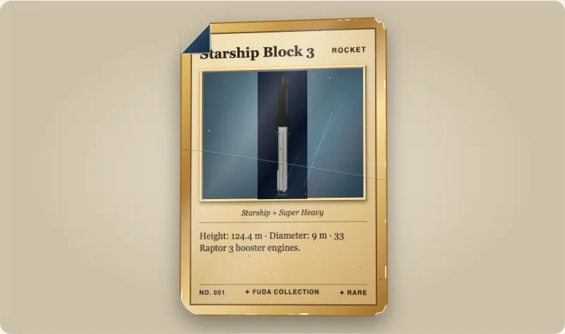

`wear`は、使われたあとのカードの見た目を描きます。柔らかくなった角、丸まった角、欠けた角、折れた角、縁の白化、折り目、傷、点状の汚れ、しみ、黄ばみ、中心からずれた印刷です。`wear`属性のないカードは、以前とバイト単位で同じです。摩耗のコードは別のモジュールで、カードが摩耗を求めたときだけ読み込まれます。



## 使い方

```html
<script type="module">import '@johnmorrisdotca/fuda-cards/element';</script>
<fuda-card title="Rookie" wear="moderately-played" wear-seed="7"></fuda-card>
<fuda-card title="Half worn" wear="0.5"></fuda-card>
<fuda-card title="Only the corners" wear-corners="0.9"></fuda-card>
```

`wear`には、プリセットのID、またはすべての度合いを一度に決める0から1の数を指定します。プリセットは、一般的な状態評価の言葉で、`mint`、`near-mint`、`lightly-played`、`moderately-played`、`heavily-played`、`damaged`です。`perfect`、属性なし、パッケージが知らない名前は、何も描きません。`wear-corners`、`wear-edges`、`wear-surface`、`wear-creases`（それぞれ0から1）は、プリセットに重ねて、1種類だけを変えます。

## シード

`wear-seed`（整数、初期値1）は、傷や汚れの位置を決めます。カードはどの端末でも毎回同じに見えます。同じシードなら同じ位置に同じ印が付き、別のシードなら別の印になります。描画時に乱数は使わず、動くこともありません。

## データとしての摩耗

パッケージは、ページに触れずに仕組み全体を公開しているので、`<fuda-card>`以外にも使い込んだカードを描けます。ポスター、PDF、サーバーで作る画像などです。

```ts
import { wearLayout, wearLevels, wearOverlaySvg, wearPreset, wearPresets } from '@johnmorrisdotca/fuda-cards';

console.log(wearPresets.length);
console.log(wearPreset('lightly-played')?.says);
const levels = wearLevels({ wear: 'lightly-played', seed: 7 });
console.log(JSON.stringify(levels));
const layout = levels && wearLayout(levels, 7);
console.log(layout?.corners.map((corner) => corner.kind).join(' '));
console.log(layout ? wearOverlaySvg(layout, 'front').startsWith('<svg') : false);
console.log(wearLevels({ wear: 'perfect' }));
// 7
// Very slight corner rounding, whitening on one or two edges, scratches seen when tilted.
// {"corners":0.38,"edges":0.45,"surface":0.4,"creases":0,"toning":0.05,"centering":0.3}
// rounded rounded soft soft
// true
// null
```

`wearLevels`は、カードが求める度合いを返し、何も求めていなければ`null`を返します。つまり`null`は「何も描かない」の意味です。`wearLayout(levels, seed)`はすべての印の位置を返し、`wearOutline`は欠けた角や折れた角を含むカードの輪郭をパスとして返し、`wearOverlaySvg`は表か裏の印をSVGの文字列として返します。

## 描かれるもの

| 種類 | 見え方 | どの度合いから |
|---|---|---|
| 角 | 鋭い、柔らかい、丸い、欠けた、折れた（裏が見える折り返し）。折れた角は最大1つ、欠けた角は最大2つ。 | すべて |
| 縁 | 4辺に沿った、むき出しの用紙のクリーム色の細かい点。 | すべて |
| 表面 | 細く明るい傷と、暗いまたは明るい点状の汚れ。 | すべて |
| 折り目 | 明るい側と影の側を持つ曲線。強いものは印刷も途切れさせる。 | `moderately-played`以上 |
| 変色としみ | 縁に向かう黄褐色の暗がり。強く使うと柔らかいしみ。 | `lightly-played`以上 |
| 中心ずれ | 印刷が、幅300 pxで最大横7 px、縦5 pxずれる。 | すべて |

状態評価の言葉は、評価会社自身のページに記載がなかったため、二次的な資料から取っています。出典と各プリセットの度合いは[docs/wear.md](../../wear.md)にあります（英語）。プリセットは、これらの言葉をこのパッケージなりに読み取ったもので、公式のグレードではありません。摩耗は、`<fuda-collection>`の画像や、山の一番上より下のカードには描かれません。
