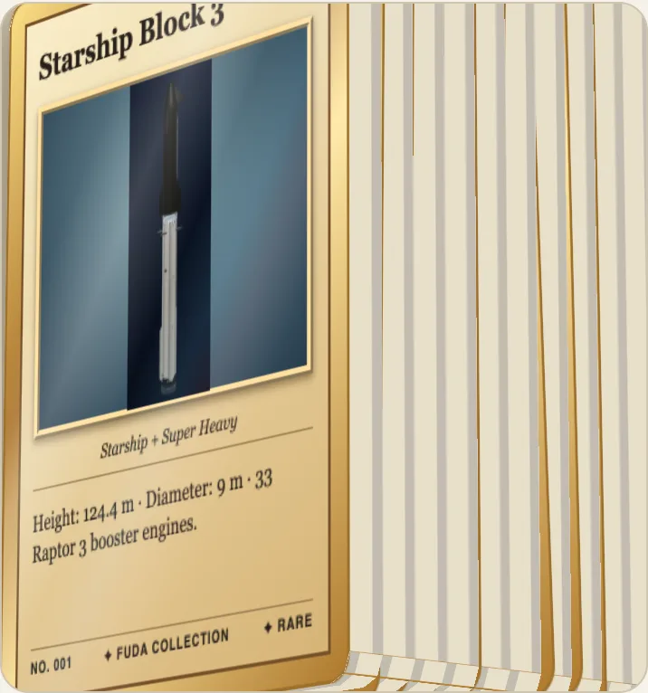
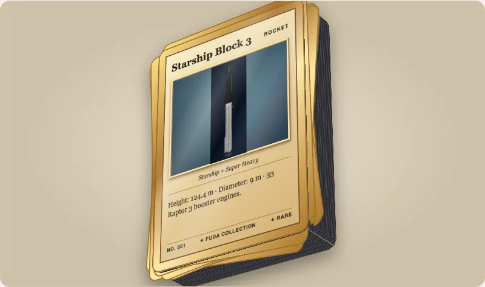

A Fuda card has a thickness, and a stack of cards is as high as its count times that thickness. Both are drawn to scale at the 63 mm wide card size, so a deck of 52 looks as tall as a deck of 52 is.



## Thickness

`thickness` is in millimetres. The default is `0.3` (about 12 pt stock); `0` is a flat card. A `material` takes the thickness, and the edge colour, of a real stock, and `thickness` still overrides it.

```html
<script type="module">import '@johnmorrisdotca/fuda-cards/element';</script>
<fuda-card title="Thin" thickness="0.3"></fuda-card>
<fuda-card title="Trading card, 130 pt" material="card-130pt"></fuda-card>
<fuda-card title="Metal" material="steel-0.5"></fuda-card>
```

Every material's thickness was read from a maker's page or a standard, and the table in [docs/materials.md](../materials.md) names the source and quotes what it says. The ids come in four groups: `paper-250`, `paper-310-black-core` and `paper-350` (card stock), `plastic-id1` (a bank-size card), `card-35pt` to `card-180pt` and `booklet-175pt` (thick trading cards) and `aluminium-0.8` and `steel-0.5` (metal). Read them in code:

```ts
import { cardMaterials, mmPerPoint } from '@johnmorrisdotca/fuda-cards';

const thick = cardMaterials.filter((material) => material.group === 'thick-card');
console.log(thick.length, thick[0].id, thick[0].thicknessMm);
console.log(130 * mmPerPoint);
// 7 card-35pt 0.889
// 3.302
```

The edge colour is a look, not a measurement. Set `--fuda-edge` on the card to any CSS background to use your own.

## Stacks

`stack="52"` draws 52 cards: the top card is the live card and the block under it is one piece with a fine line for each card. The count is free, 1 to 1000.

```html
<script type="module">import '@johnmorrisdotca/fuda-cards/element';</script>
<fuda-card title="Deck" material="paper-310-black-core" stack="52" stack-messiness="0.6" stack-seed="7" stack-depth="10"></fuda-card>
```

| Attribute | Range | Default | Meaning |
|---|---|---|---|
| `stack` | 1 to 1000 | 1 | How many cards. |
| `stack-messiness` | 0 to 1 | 0.3 | 0 squared up, 1 very messy. |
| `stack-seed` | whole number | 1 | The same seed lays the same stack the same way. |
| `stack-depth` | 0 to 52 | 10 | How many cards under the top one are laid out nudged and turned. |

A card put on top of the stack moves none of those under it, because each card's place depends on its number from the bottom. The cards under the top one are flat stills with no text, and a stack of 52 draws no more than one of 11. A stack draws nothing while it is at rest, and a test checks that a 52-card stack requests no frames.

`stackPresets` are four counts with a source: two decks of playing cards (52 and 54), a Pokémon deck of 60 and a booster pack of 10. Work out the height of any pile in code without a card on the page:

```ts
import { cardMaterial, stackHeightMm, stackLayout, stackPresets } from '@johnmorrisdotca/fuda-cards';

const stock = cardMaterial('paper-310-black-core');
console.log(stackHeightMm(52, stock?.thicknessMm ?? 0.3));
console.log(stackPresets.map((preset) => preset.count).join(' '));
console.log(stackLayout(5, { messiness: 0, seed: 1 }).length);
// 16.9
// 52 54 60 10
// 4
```



## Reading a stack from script

`card.stackCount` and `card.stackHeight` (in millimetres) are read-only. To spread a stack open or take a card off it, see [Binders and piles](binder-and-piles.md). The idea of a pile from neat to messy comes from [toranpu](https://github.com/johnmorrisdotca/toranpu).
