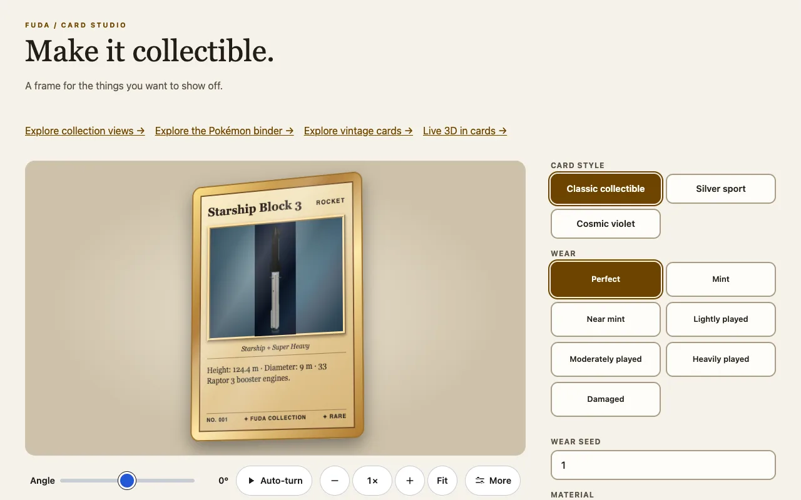

Three separate things move on a card, and none depends on another: the **art** can pan, the **card** can spin, and the card can be **turned over** (`flipped`, see [The card element](card-element.md)). All of them stop when the reader's system asks for reduced motion.

## Moving artwork

`motion="pan"` on a card with a slotted `` enables an Animate button on a tall image. The button is a small play or pause mark in the corner of the art, drawn at half strength until you point at it or focus it. Its hit target is 48 px square, its accessible name is "Animate the picture" and `aria-pressed` says whether the art is moving.

```html
<script type="module">import '@johnmorrisdotca/fuda-cards/element';</script>
<fuda-card title="Starship" motion="pan" pan-direction="down" style="--fuda-pan-duration: 16s">
  
</fuda-card>
```

| Attribute or property | Meaning |
|---|---|
| `motion="pan"` | Allows the pan and shows the button. |
| `playing` | Start moving. A host can add or remove it; the button toggles it. |
| `pan-direction` | `down` (default) or `up`, which starts at the bottom. |
| `pan-loop` | `alternate` (default, back and forth) or `restart`. |
| `--fuda-pan-duration` | The time of each pass, a CSS duration such as `16s`. |
| `--fuda-focus-x`, `--fuda-focus-y` | The focal point of the still, such as `50%` and `20%`. |
| `moving` | Set by the card while the art moves, for styling. Read-only: set `playing` or `autoplay` instead. |

If the image is not taller than the card's window after it fills the width, there is no vertical distance and nothing pans.

## Autoplay on focus

`autoplay="focus"` moves the art by itself while the card is the card in focus. One card is in focus at a time: the card under the mouse, the card holding keyboard focus (tab to its button), or, on a touch screen, the card you last tapped. When focus moves, the first card returns to its still, so in a row or a grid only one card ever moves. The button stays, and pressing it pauses the card until the next time it takes focus. Autoplay never starts with `prefers-reduced-motion: reduce`.

```html
<script type="module">import '@johnmorrisdotca/fuda-cards/element';</script>
<fuda-card title="Starship" motion="pan" autoplay="focus">
  
</fuda-card>
```

## Spinning the whole card

`card-spin="center"` turns the whole card slowly in 3D about its vertical centre; `card-spin="corner"` spins it like an ice skater, a full turn about the vertical axis through its bottom-left corner, which stays still at the middle of the element and shows the back half way round. The corner spin sweeps out to both sides of that point, so give it room: a stage about three times the card's width and twice its height.

```html
<script type="module">import '@johnmorrisdotca/fuda-cards/element';</script>
<fuda-card title="Explorer" card-spin="center" style="--fuda-card-spin-duration: 30s"></fuda-card>
<fuda-card title="Skater" card-spin="corner" card-spin-direction="reverse" card-spin-paused></fuda-card>
```

The default is one turn every 180 seconds; `--fuda-card-spin-duration` is any positive CSS duration. `card-spin-direction="reverse"` reverses it, `card-spin-paused` pauses at the current angle and removing it resumes, and removing `card-spin` stops and resets the card.

## Driving the turn yourself

Add the boolean `card-view` attribute and the built-in animation is replaced by two CSS custom properties you set: `--fuda-yaw` and `--fuda-tilt`, as angles. The pivot is still the one chosen by `card-spin`. The Card Studio does this with the view controls of kazoku-ui, which also zoom and pan the whole stage so the full sweep can always be seen.

```html
<script type="module">import '@johnmorrisdotca/fuda-cards/element';</script>
<fuda-card id="driven" title="By hand" card-view style="--fuda-yaw: 40deg; --fuda-tilt: 10deg"></fuda-card>
<script type="module">
  const card = document.querySelector('#driven');
  card.style.setProperty('--fuda-yaw', '-30deg');
</script>
```



## Reduced motion

With `prefers-reduced-motion: reduce` the rotation, the flip transition, the pan and autoplay are all disabled and the card keeps its focused still. The spin is decorative: use the `flipped` attribute, not a spin, to choose the face.
