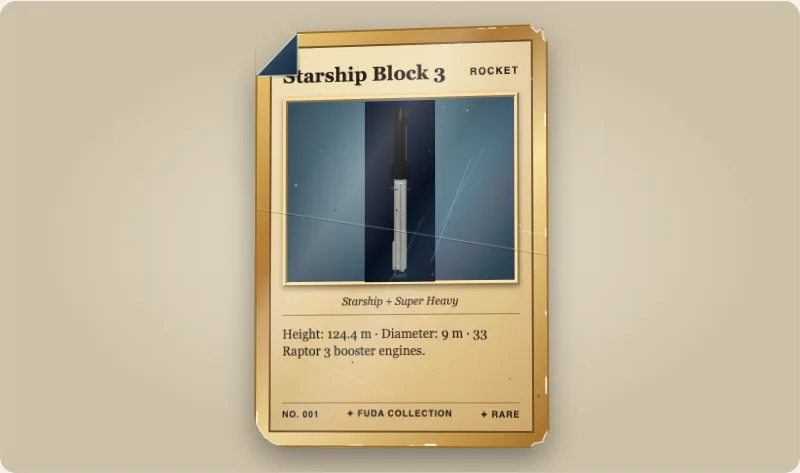

`wear` draws a card the way it looks after use: soft, rounded, chipped or folded corners, whitening on the edges, creases, scratches, specks, staining, yellowing and a print that sits off centre. A card with no `wear` attribute is byte for byte what it was before, and the wear code is a separate module that is loaded only when a card asks for wear.



## Use it

```html
<script type="module">import '@johnmorrisdotca/fuda-cards/element';</script>
<fuda-card title="Rookie" wear="moderately-played" wear-seed="7"></fuda-card>
<fuda-card title="Half worn" wear="0.5"></fuda-card>
<fuda-card title="Only the corners" wear-corners="0.9"></fuda-card>
```

`wear` is a preset's id or a number from 0 to 1 that sets every level at once. The presets are the plain grading words: `mint`, `near-mint`, `lightly-played`, `moderately-played`, `heavily-played` and `damaged`. `perfect`, no attribute, or a name the package does not know draws nothing. `wear-corners`, `wear-edges`, `wear-surface` and `wear-creases` (each 0 to 1) change one kind on its own, over the preset's.

## The seed

`wear-seed` (a whole number, default 1) fixes where the marks lie. A card looks the same every time and on every device: the same seed lays the same marks, another seed lays others. Nothing is random at draw time and nothing moves.

## Wear as data

The package exports the whole machine without touching the page, so you can draw a worn card into something that is not a `<fuda-card>`: a poster, a PDF or a server-rendered image.

```ts
import { wearLayout, wearLevels, wearOverlaySvg, wearPreset, wearPresets } from '@johnmorrisdotca/fuda-cards';

console.log(wearPresets.length);
console.log(wearPreset('lightly-played')?.says);
const levels = wearLevels({ wear: 'lightly-played', seed: 7 });
console.log(JSON.stringify(levels));
const layout = levels && wearLayout(levels, 7);
console.log(layout?.corners.map((corner) => corner.kind).join(' '));
console.log(layout ? wearOverlaySvg(layout, 'front').startsWith('<svg') : false);
console.log(wearLevels({ wear: 'perfect' }));
// 7
// Very slight corner rounding, whitening on one or two edges, scratches seen when tilted.
// {"corners":0.38,"edges":0.45,"surface":0.4,"creases":0,"toning":0.05,"centering":0.3}
// rounded rounded soft soft
// true
// null
```

`wearLevels` gives the levels a card asks for, or `null` when it asks for none, so `null` means "draw nothing". `wearLayout(levels, seed)` says where every mark lies, `wearOutline` gives the card's silhouette with its chipped and folded corners as a path, and `wearOverlaySvg` gives the marks as SVG text for the front or the back.

## What is drawn

| Kind | What you see | From which level |
|---|---|---|
| Corners | Sharp, soft, rounded, chipped or folded (a dog-ear that shows the back); at most one folded and two chipped. | Any |
| Edges | Cream flecks of bare stock along the four edges. | Any |
| Surface | Thin light scratches and dark or light specks over the face. | Any |
| Creases | Curved lines with a light and a shadow side; a heavy one breaks the print. | `moderately-played` and up |
| Toning and staining | A yellow-brown darkening towards the edges, and from heavy wear a soft stain. | `lightly-played` and up |
| Centering | The print sits off centre by up to 7 px across and 5 px down, at 300 px wide. | Any |

The grading words come from secondary sources, because the grading companies' own pages did not answer; [docs/wear.md](../wear.md) lists them, with the level of every preset. The presets are this package's reading of those words, not a grade. Wear is not drawn on the images of a `<fuda-collection>` or on the cards under the top of a stack.
